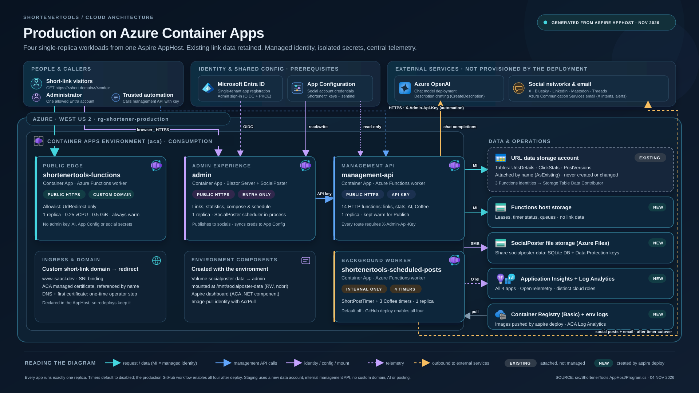

# ShortenerTools

A personal URL shortener and social-publishing toolkit, hosted on **Azure Container Apps** and described entirely by a
**.NET Aspire AppHost**. It started life as a fork of
[TinyBlazorAdmin](https://github.com/FBoucher/TinyBlazorAdmin) and has since grown into four cooperating services:

- **Short-link redirects** — a public endpoint that resolves `https://<your-domain>/<code>` to its destination and records
  a click (referrer, user agent, page) in Azure Table Storage.
- **Admin site (SocialPoster)** — a server-rendered Blazor app, locked to one Microsoft Entra account, for creating,
  editing and archiving links, viewing click statistics, and composing/scheduling social posts with AI-drafted text.
- **Management API** — an API-key-protected Azure Functions app that the admin site (and trusted automation) calls to
  manage links, read statistics, generate descriptions with Azure OpenAI, and trigger Coffee & Open Source posts.
- **Scheduled posting** — an internal Functions app with timers that post new links (weekdays, four times a day) and
  Coffee & Open Source teasers, announcements and archive posts to X, Bluesky, LinkedIn, Mastodon and Threads.



*Production topology generated from the Aspire AppHost. See [Architecture](doc/architecture.md) for flows and
[Azure resources](doc/azure-resources.md) for the full inventory; the diagram's notes and sources are in
[azure-production-architecture.md](doc/azure-production-architecture.md).*

## Documentation

| Guide                                                    | Read it when you want to…                                                                     |
|----------------------------------------------------------|-----------------------------------------------------------------------------------------------|
| [Architecture](doc/architecture.md)                      | Understand the services, how requests flow, and the security boundaries between them.         |
| [Azure resources](doc/azure-resources.md)                | Know exactly what a deployment creates (and what it expects to already exist) in Azure.       |
| [Deployment](doc/deployment.md)                          | Set up Azure/GitHub once, then deploy with the scripts or GitHub Actions; staging; cutover.   |
| [Configuration reference](doc/configuration.md)          | Look up any parameter, secret, environment variable, or feature switch.                       |
| [Local development](doc/local-development.md)            | Run everything on your machine with Aspire, Azurite and Ollama; debug; run tests.             |
| [Management API](doc/management-api.md)                  | Call the API directly (curl/PowerShell) or from automation.                                   |
| [Operations](doc/operations.md)                          | Verify a deployment, monitor it, toggle timers, rotate secrets, troubleshoot, tear down.      |

The production architecture diagram and its notes live in [azure-production-architecture.md](doc/azure-production-architecture.md).

Background material from the migration off Static Web Apps / Function Apps is kept for reference:
[production deployment notes](doc/production-deployment.md) and the [admin README](src/ShortenerTools.Admin/README.md).
Where those older notes disagree with the guides above, the guides above match the current code.

## Repository layout

```text
.
├── aspire.config.json                 # Points the Aspire CLI at the AppHost
├── .github/workflows/
│   └── azure-container-apps.yml       # CI validation + manual production deployment
├── doc/                               # Documentation (this folder)
└── src/
    ├── shortenerTools.sln
    ├── Directory.Build.props          # Target framework + Aspire version for every project
    ├── Directory.Packages.props       # Central NuGet package versions
    ├── ShortenerTools.AppHost/        # Aspire AppHost: the single source of truth for local + Azure topology
    ├── ShortenerTools.Functions/      # Azure Functions (isolated worker): redirect, management API, timers
    ├── ShortenerTools.Admin/          # Blazor Server admin site hosting SocialPoster
    ├── ShortenerTools.Core/           # Shared domain: table entities, storage helper, Coffee, email
    ├── ShortenerTools.ServiceDefaults/# OpenTelemetry, health checks, resilience, service discovery
    ├── ShortenerTools.Tests/          # MSTest suite
    └── tools/                         # Deployment helper, artifact checker, offline tests, Postman collection
```

The same `ShortenerTools.Functions` build is deployed **three times** with different function allowlists
(`AzureFunctionsJobHost__functions__N`), so the public redirect container physically cannot serve management routes or
run timers. See [Architecture](doc/architecture.md#one-functions-build-three-apps).

## Quick start (local)

Prerequisites: a .NET SDK that can build the `TargetFramework` in `src/Directory.Build.props`, the [Aspire CLI](https://aspire.dev) 13.6.1,
Azure Functions Core Tools v4, and Docker Desktop (Linux containers). You also need a Microsoft Entra app registration
for admin sign-in — see [Local development](doc/local-development.md#1-create-an-entra-app-registration-for-local-sign-in).

```powershell
# One-time: required AppHost parameters (use a secret manager for the secret ones)
$p = 'src\ShortenerTools.AppHost'
dotnet user-secrets set "Parameters:entra-tenant-id"         "<tenant-guid>"        --project $p
dotnet user-secrets set "Parameters:entra-client-id"         "<app-client-guid>"    --project $p
dotnet user-secrets set "Parameters:entra-client-secret"     "<client-secret>"      --project $p
dotnet user-secrets set "Parameters:administrator-object-id" "<your-object-guid>"   --project $p
dotnet user-secrets set "Parameters:admin-api-key"           "<long-random-string>" --project $p
dotnet user-secrets set "Parameters:custom-domain"           "https://localhost:5001" --project $p
dotnet user-secrets set "Parameters:default-redirect-url"    "https://example.com"  --project $p

# Run everything (Azurite, Ollama, three Functions apps, admin, Aspire dashboard)
aspire start --apphost src\ShortenerTools.AppHost\ShortenerTools.AppHost.csproj --launch-profile https
```

Open the Aspire dashboard link printed by the CLI, then the **admin** HTTPS endpoint. Locally all timers are disabled and
the management API runs as a dry run; SocialPoster's own *Publish* still posts to whatever accounts you connect in its
Settings, so use test accounts. Full details: [Local development](doc/local-development.md).

## Deploying to Azure (summary)

All Azure infrastructure is generated from the AppHost as Bicep by `aspire publish` and applied by `aspire deploy`.
There is no hand-written ARM/Bicep to maintain.

| Path                                   | Use it for                                    | How                                                                                         |
|----------------------------------------|-----------------------------------------------|---------------------------------------------------------------------------------------------|
| GitHub Actions (recommended)           | Production                                    | Actions → **Aspire Azure Container Apps** → *Run workflow* on `main`                         |
| `src/tools/Invoke-ProductionDeployment.ps1` | Production from your machine; dry runs  | `-Mode Validate` → `-Mode Publish` → `-Mode Deploy`                                          |
| `aspire deploy --environment Staging`  | A disposable, side-effect-free staging copy   | Direct Aspire CLI with a separate resource group                                            |

> [!WARNING]
> Running the production GitHub workflow **enables all four posting timers** (shortener + three Coffee & Open Source
> timers). Disable any legacy hosts that run the same timers first, or you will double-post.
> Running the helper script locally keeps timers **disabled** unless you pass `-EnableScheduler` /
> `-EnableCoffeeScheduler`.

Start with [Deployment](doc/deployment.md); it walks through one-time setup (Entra, App Configuration, Azure OpenAI,
email, OIDC deployment identity, GitHub environment, custom domain) and every script parameter.

## Safety defaults

The code is deliberately conservative about anything that can post publicly or touch production data:

- **Timers are off by default** in every environment. Production timers are switched on only by an explicit cutover
  (`-EnableScheduler`, `-EnableCoffeeScheduler`, or the GitHub workflow). Local and Staging force them off even if asked.
- **Staging can never post**: `DisableExternalPosting=true`, `PostSocials=false`, no social/email/AI credentials are
  passed in, and the environment name itself blocks sends in `ShortenerSettings.ExternalPostingAllowed`.
- **Local runs are dry runs**: the management API runs with `DisableExternalPosting=true`.
- **The public redirect app** gets no admin key, AI connection or social credentials, and only `UrlRedirect` is enabled.
- **Every management route** requires the `X-Admin-Api-Key` header (constant-time compare), even when publicly reachable.
- **The deployment helper never prints configuration** and suppresses Aspire output, because tool errors can echo secrets.

## Tech stack

.NET (isolated-worker Azure Functions v4, ASP.NET Core Blazor Server), .NET Aspire 13.6 (`Aspire.Hosting.Azure.AppContainers`,
`.Functions`, `.ApplicationInsights`), Azure Container Apps (Consumption), Azure Table Storage, Azure Files,
Azure App Configuration, Azure OpenAI / Ollama via `Microsoft.Extensions.AI`, Azure Communication Services Email,
MudBlazor, [SocialPoster](https://github.com/isaacrlevin/SocialPoster) (`SocialPoster.Components` for the admin UI,
`SocialPoster.Posting` for all social posting), OpenTelemetry → Azure Monitor, MSTest.

## Credits

Originally based on
[TinyBlazorAdmin](https://github.com/FBoucher/TinyBlazorAdmin) by Frank Boucher and contributors
(see the [admin README](src/ShortenerTools.Admin/README.md#contributors-) for the contributor list).
