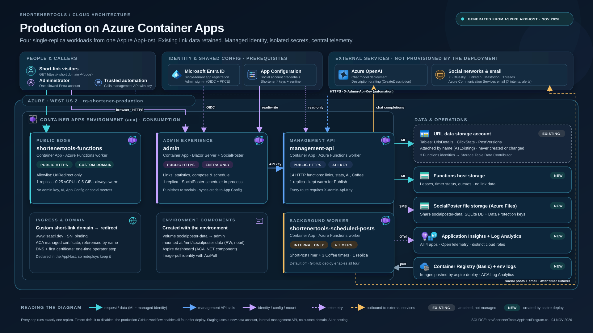
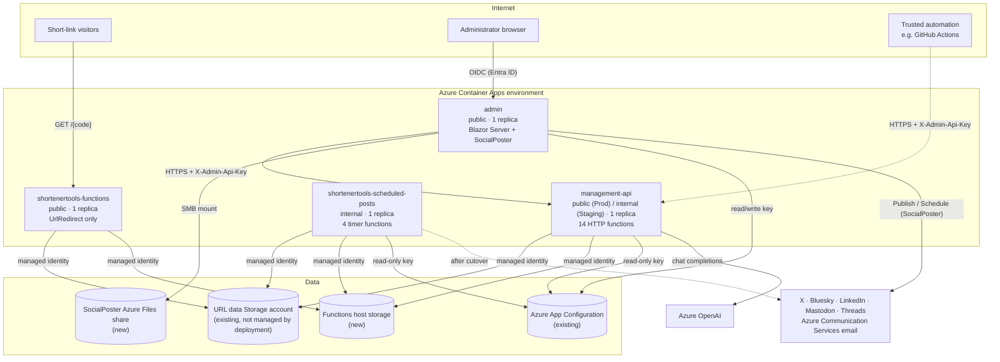
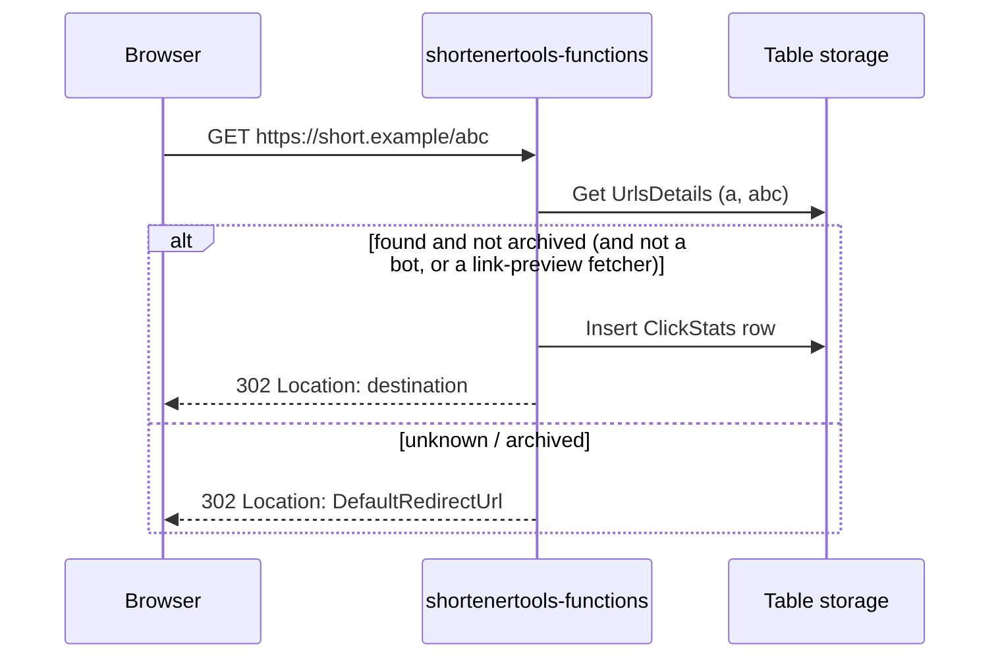
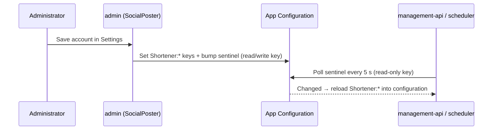

# Architecture

This document explains how ShortenerTools is put together: the four running services, how a request moves through
them, where data lives, and the boundaries that keep the public parts of the system away from secrets.

For the Azure resources that host all of this, see [Azure resources](azure-resources.md).

- [The big picture](#the-big-picture)
- [Projects](#projects)
- [One Functions build, three apps](#one-functions-build-three-apps)
- [Services in detail](#services-in-detail)
- [Social posting (SocialPoster)](#social-posting-socialposter)
- [Data model](#data-model)
- [Key flows](#key-flows)
- [Security boundaries](#security-boundaries)
- [Environments: local, Staging, Production](#environments-local-staging-production)
- [Telemetry](#telemetry)

## The big picture

The diagram above is the presentation view of Production (notes and icon sources in
[azure-production-architecture.md](azure-production-architecture.md)). The Mermaid version below shows the same flows in
a form that's easy to edit.

The **AppHost** (`src/ShortenerTools.AppHost/Program.cs`) is the single source of truth for this topology. The same file
drives:

- `aspire start` — local orchestration with emulators and a dashboard;
- `aspire publish` — Bicep generation (no Azure calls);
- `aspire deploy` — container build/push and Bicep deployment to Azure.

## Projects

| Project                          | Kind                                  | Purpose                                                                                                                                                                         |
|----------------------------------|---------------------------------------|---------------------------------------------------------------------------------------------------------------------------------------------------------------------------------|
| `ShortenerTools.AppHost`         | Aspire AppHost (`Aspire.AppHost.Sdk`) | Declares every resource, parameter, environment variable, role assignment, scale rule and ingress setting. Branches on run vs. publish mode and on `Staging` vs. `Production`. |
| `ShortenerTools.Functions`       | Azure Functions v4, isolated worker   | All HTTP and timer functions. Deployed as three separate Container Apps.                                                                                                       |
| `ShortenerTools.Admin`           | ASP.NET Core Blazor Server            | Entra-protected admin UI: SocialPoster workspace (compose, links, contacts, history, settings), URL manager, statistics.                                                        |
| `ShortenerTools.Core`            | Class library                         | Table entities (`ShortUrlEntity`, `ClickStatsEntity`, `PostVersionEntity`), `StorageTableHelper`, shortcode policy, the `SocialPost` envelope, X intent-link helper, Coffee feed + post factory, email service. (Posting itself is in the SocialPoster.Posting package.) |
| `ShortenerTools.ServiceDefaults` | Class library                         | Aspire service defaults: OpenTelemetry (OTLP and/or Azure Monitor), health checks (`/health`, `/alive` in Development), HTTP resilience, service discovery.                      |
| `ShortenerTools.Tests`           | MSTest                                | Unit/integration tests covering redirects, shortcode creation/retry, API-key middleware, admin access rules, staging safety, telemetry config, Coffee scheduling, statistics.   |

The Coffee & Open Source functions live in `ShortenerTools.Functions/Functions/CoffeeOpenSource.cs` (they replaced the
standalone `CoffeeOpenSourceScheduler` project).

## One Functions build, three apps

The AppHost calls `AddAzureFunctionsProject<Projects.ShortenerTools_Functions>(...)` three times. Each copy restricts the
functions the host will load with `AzureFunctionsJobHost__functions__<n>` and gets its own host ID
(`AzureFunctionsWebHost__hostid`) so leases and timer checkpoints in the shared host-storage account never collide.

| Container App                    | Host ID                 | Functions loaded                                                                                                                                                                                                            |
|----------------------------------|-------------------------|-----------------------------------------------------------------------------------------------------------------------------------------------------------------------------------------------------------------------------|
| `shortenertools-functions`       | `shortener-redirect`    | `UrlRedirect`                                                                                                                                                                                                               |
| `management-api`                 | `shortener-management`  | `UrlList`, `UrlCreate`, `UrlCheck`, `UrlUpdate`, `UrlArchive`, `UrlStats`, `UrlClickStatsByDay`, `UrlPostVersions`, `CreateDescription`, `ShortPostHttp`, `TestShortUrl`, `COSSPublishHttp`, `COSSTeaserHttp`, `COSSAnnouncementHttp`, `COSSArchiveHttp` |
| `shortenertools-scheduled-posts` | `shortener-scheduler`   | `ShortPostTimer`, `COSSTeaserTimer`, `COSSAnnouncementTimer`, `COSSArchiveTimer`                                                                                                                                            |

In addition, every timer that is *not* meant to run in an app is explicitly disabled there with
`AzureWebJobs.<Function>.Disabled=true`, and the scheduler's own timers are gated by deployment parameters (see
[Scheduler cutover](deployment.md#scheduler-cutover-and-rollback)).

`host.json` sets an **empty HTTP route prefix**, so function routes are exactly what their `Route =` attribute says:
management routes already include `api/` (for example `/api/UrlList`), Coffee routes have no explicit route
(`/COSSPublishHttp`), and the redirect catches `/{shortUrl}`.

This is why `src/tools/Test-AcaArtifacts.ps1` asserts the allowlists in the generated Bicep: if a future change loaded
`UrlCreate` into the public app, CI would fail.

## Services in detail

### `shortenertools-functions` — public redirect

- **Route:** `GET /{shortUrl}`; anonymous by design (the only function the API-key middleware skips).
- **Behaviour:**
  - `robots.txt` or any path containing a `.` → `200` with a robots body that allows only the link-preview fetchers
    (see below) and disallows everyone else.
  - Known, non-archived code → records a `ClickStats` row, then `302` to the destination.
  - User agent containing `bot` → `200` robots body (no click recorded, no redirect), **except** the link-preview
    fetchers of the networks SocialPoster posts to (Twitterbot (X), LinkedInBot, facebookexternalhit (Facebook/Threads) and Bluesky Cardyb). Those are redirected like a visitor so they can
    build a card; see [Link previews](#link-previews).
  - Unknown or archived code → `302` to `DefaultRedirectUrl`.
- **Scale:** exactly one always-on replica, 0.25 vCPU / 0.5 GiB, so redirects never wait on a cold start.
- **Custom domain:** in Production the hostname is proxied through Cloudflare, and the ingress declares it with an
  existing Cloudflare Origin CA certificate uploaded to the ACA environment, so redeployments keep the binding.
- **Visitor location:** see [Visitor location](#visitor-location).
- **Receives:** table endpoint, host storage, `DefaultRedirectUrl`, telemetry. **Never** the admin key,
  AI connection, App Configuration credential, or social/email secrets.

### `admin` — administrator UI and SocialPoster

- Blazor Server (interactive server rendering) with MudBlazor. Pages: `/` and `/socialposter/{Section}` (SocialPoster
  workspace), `/urlmanager`, `/statistics`, `/statistics/{vanity}`, `/help`, `/login`, `/unauthorized`.
- **Sign-in:** OpenID Connect against `https://login.microsoftonline.com/<tenant>/v2.0` (authorization code + PKCE).
  After token validation, the `tid` and `oid` claims must equal `Entra:TenantId` and `Entra:AdministratorObjectId`;
  anyone else is rejected and never receives a cookie. The cookie is `__Host-ShortenerAdmin`, HTTP-only, Secure, 8 hours.
- **Calls the management API server-side** through Aspire service discovery (`https+http://management-api`) with the
  `X-Admin-Api-Key` header. The key never reaches the browser. Normal calls use a 60 s attempt / 90 s total budget;
  description generation uses a separate 120 s client. Unsafe methods (POST) are never retried automatically.
- **SocialPoster** keeps its SQLite database (accounts, GitHub Copilot sign-in, contacts, history, schedules, uploaded
  media) and ASP.NET Data Protection keys in `SocialPoster:DataDirectory`. In Azure this is an Azure Files share mounted at
  `/mnt/socialposter-data`; locally it is `src/ShortenerTools.Admin/socialposter-data`.
- SocialPoster's own scheduling worker runs inside this process, which is why the app is pinned to **exactly one
  replica** (single writer for SQLite, and the scheduler must keep polling).
- **Credential sync:** `SocialAccountsConfigurationPublisher` mirrors the Bluesky, X, LinkedIn, Mastodon and Threads credentials
  entered in SocialPoster *Settings* into Azure App Configuration every 5 seconds (keys `Shortener:*`, plus the sentinel
  `SocialPoster:Accounts:Sentinel`). It refuses to publish an empty store over existing values.
- Until the SQLite store is open, requests get `503 Retry-After: 5` for up to 15 seconds.

### `management-api` — management, statistics, AI, manual posting

- Fourteen HTTP functions (see [Management API](management-api.md)). All of them pass through
  `AdminApiKeyMiddleware`, which compares `X-Admin-Api-Key` with `AdminApiKey` using SHA-256 + fixed-time comparison and
  returns `401` otherwise.
- **Ingress:** public HTTPS in Production (so external automation can call the Coffee endpoints), internal-only in
  Staging. Locally it is internal to Aspire.
- **AI:** `CreateDescription` uses `Microsoft.Extensions.AI` with Azure OpenAI (`ConnectionStrings__chat` +
  `DeploymentName`) in Azure, or a local Ollama `llama3` model in local runs. Sensitive-content telemetry is disabled.
  In Staging the AI client is never registered and the endpoint returns `503`.
- **Social credentials:** reads the App Configuration store with a **read-only** key and refreshes when the sentinel
  changes (middleware-triggered, 5 s interval).
- **Scale:** exactly one always-on replica so the admin's Publish button does not stall on a ~20 s cold start.

### `shortenertools-scheduled-posts` — timers

| Function                | NCRONTAB (UTC)              | What it does                                                                                                                         |
|-------------------------|-----------------------------|--------------------------------------------------------------------------------------------------------------------------------------|
| `ShortPostTimer`        | `0 0 13,16,19,23 * * 1-5`   | Weekdays 13:00/16:00/19:00/23:00 UTC: picks the **oldest** link with `Posted=false`, posts it (per-platform versions if any), marks it posted. |
| `COSSTeaserTimer`       | `0 0 17 * * MON`            | Mondays 17:00 UTC: teaser for a Coffee & Open Source guest airing within the next 5 days.                                           |
| `COSSAnnouncementTimer` | `0 0 17 * * *`              | Daily 17:00 UTC: announcement for a guest airing within the next 3 hours.                                                           |
| `COSSArchiveTimer`      | `0 0 16 * * MON`            | Mondays 16:00 UTC: re-shares a random published episode.                                                                             |

- Coffee guest data comes from
  [`guests.json`](https://raw.githubusercontent.com/isaacrlevin/CoffeeAndOpenSource.com/main/data/guests.json).
- **Internal ingress only**, exactly one replica (a Functions timer listener must stay alive; scale-to-zero would miss
  executions).
- Posting goes through `SocialPosterPublisher`, using the same SocialPoster clients as the admin. See
  [Social posting](#social-posting-socialposter).

## Social posting (SocialPoster)

[SocialPoster](https://github.com/isaacrlevin/SocialPoster) is the only code in this system that talks to social
networks. Both packages are pinned together in `src/Directory.Packages.props`:

| Package                   | Used by                    | Provides                                                                                                  |
|---------------------------|----------------------------|-----------------------------------------------------------------------------------------------------------|
| `SocialPoster.Components` | admin                      | Compose & schedule UI, accounts, contacts, history, and the in-process scheduling worker.                  |
| `SocialPoster.Posting`    | admin and all Functions apps | The X, Bluesky, LinkedIn, Mastodon and Threads clients, per-platform rendering (mentions, character limits) and link previews. |

There are two callers of those clients:

| Caller                                                       | Credentials come from                                                                                              |
|--------------------------------------------------------------|--------------------------------------------------------------------------------------------------------------------|
| **admin** — *Publish* and *Schedule* in SocialPoster          | SocialPoster's own encrypted SQLite store (the Azure Files share).                                                 |
| **Functions** — `ShortPostTimer`, Coffee timers and endpoints | App Configuration (`Shortener:*` keys, synced from the admin's store). `SocialPosterPublisher` copies them into a fresh in-memory credential set for each attempt. |

How the Functions apps post (`SocialPosterPublisher`):

- Each network gets its own text (per-platform `PostVersions`, Coffee handles, or the shared text), rendered by
  SocialPoster. A post over that network's character limit fails for that network; it is not trimmed.
- **X:** posts through the X API when all four X credentials are present. Otherwise it emails `EmailTo` a pre-filled
  X "intent" link (with `Shortener:TwitterViaHandle` as the `via=` attribution, if set) for you to post by hand.
- Networks are attempted one at a time and independently. A failure is logged and emailed to `EmailTo`; the remaining
  networks still post. Nothing is sent at all when external posting isn't allowed (Staging, local dry runs).
- The Mastodon and Threads HTTP clients never follow redirects, so a token can't be forwarded to another host.

### Link previews

Every post is text with a link in it. What the link turns into depends on the network:

| Network  | What readers see                                     | How                                                                                                                         |
|----------|------------------------------------------------------|-----------------------------------------------------------------------------------------------------------------------------|
| Bluesky  | Link card (image, title, description)                | SocialPoster fetches the **last** link's Open Graph data (Bluesky's card service, falling back to scraping) and embeds it.  |
| Threads  | Link card (image, title)                             | SocialPoster sends the **last** link as the post's `link_attachment`; Threads fetches the page. Needs `SocialPoster.Posting` **0.6.6 or later**; older versions leave Threads to preview the first link on its own. |
| LinkedIn | The page's image attached to the post                | LinkedIn often fails to unfurl links posted through its API, so SocialPoster attaches the **last** link's Open Graph image. |
| X        | X's own card                                         | X fetches the link itself with Twitterbot, which the redirect app lets through (see below).                                 |
| Mastodon | The server's own preview                             | Your Mastodon server fetches the link itself.                                                                               |

In shortener and Coffee posts the link is usually a **short link**. So card data comes from fetching the short link,
which the redirect app answers with a `302` to the destination. The image and title on the card are therefore the
destination page's. How the redirect app treats those fetches:

- **Let through:** the preview fetchers of the networks SocialPoster posts to — Twitterbot (X), LinkedInBot, facebookexternalhit (Facebook/Threads) and Bluesky Cardyb — plus SocialPoster's
  own fallback scraper (`SocialPoster/1.0`). They're listed in `UrlRedirect.LinkPreviewAgents`, and `robots.txt` allows
  the same agents. Every other user agent containing `bot` still gets the robots page and no redirect. Meta's AI
  crawler (`meta-externalagent`) is deliberately not let through.
- **Counted, but flagged:** these fetches are recorded in `ClickStats` with `IsCrawler = true`, so a new post's
  Crawlers the user-agent parser recognises are flagged the same way. The statistics pages hide flagged clicks by
  default (**Hide crawler clicks** switch); older rows recorded before the flag existed are always shown.
- **Adding a network:** if a card stays blank because a network's fetcher isn't in the list, add its user-agent
  fragment to `LinkPreviewAgents` (and its robots token to `LinkPreviewRobotsTokens`); the tests in
  `UrlRedirectTests` cover both lists.

### Visitor location

The short-link hostname is proxied through Cloudflare, which adds the visitor's location to each request before it
reaches the redirect app. `UrlRedirect.ReadVisitorLocation` stores it on the click:

| `ClickStats` column | Header         | Cloudflare setting                                                       |
|---------------------|----------------|--------------------------------------------------------------------------|
| `Country`           | `CF-IPCountry` | **Network → IP Geolocation** (on by default). ISO code, e.g. `US`.       |
| `Region`            | `cf-region`    | **Managed Transforms → Add visitor location headers**                    |
| `City`              | `cf-ipcity`    | **Managed Transforms → Add visitor location headers**                    |
| `Latitude`, `Longitude` | `cf-iplatitude`, `cf-iplongitude` | **Managed Transforms → Add visitor location headers** |

- The visitor's IP address is never stored.
- `XX` (unknown) and `T1` (Tor) countries and blank values are stored as empty; values are capped at 100 characters.
- Coordinates are stored only as a valid pair, rounded to one decimal place (about 11 km).
- Clicks recorded before the hostname was proxied, and requests that reach the ACA hostname directly, have no location.
  Requests that bypass Cloudflare could send forged headers; that only affects statistics.
- The Statistics page shows a **Click Locations** map (`Shared/ClickMap.razor` + `wwwroot/js/clickMap.js`) with one
  circle per place, its area proportional to clicks: blue for clicks with coordinates, orange for older clicks that
  only have a country (drawn at the country's centre from `Shared/CountryCentroids.cs`). The **Country** and **City**
  tables below it give the exact counts, and a note says how many clicks have no location. Link-preview fetchers report
  data-centre locations, so keep **Hide crawler clicks** on.
- The map uses [Leaflet](https://leafletjs.com) 1.9.4, vendored in `wwwroot/lib/leaflet` (BSD-2-Clause, verified against
  npm's integrity hash), and the standard OpenStreetMap tiles, shown in greyscale. Tile use follows the
  [OSM tile usage policy](https://operations.osmfoundation.org/policies/tiles/) (attribution shown; fine for one admin user).

## Data model

All link data lives in **one existing Storage account** (Table service). Tables are created on first use
(`CreateIfNotExists`), so a brand-new account works too.

| Table          | PartitionKey               | RowKey                      | Contents                                                                                                                      |
|----------------|----------------------------|-----------------------------|-------------------------------------------------------------------------------------------------------------------------------|
| `UrlsDetails`  | First character of code    | Short code (vanity)         | `Url`, `Title`, `Message`, `IsArchived`, `Posted`, optional `CreationId` (idempotency token from SocialPoster drafts).         |
| `UrlsDetails`  | `1`                        | `KEY`                       | Counter row (`Id`, starts at 1024) used to generate base-36 codes when no vanity is supplied.                                 |
| `ClickStats`   | Short code                 | New GUID / ticks            | One row per redirect: timestamp, referrer, user agent, page (destination host + path + query), visitor country/region/city and rounded latitude/longitude. |
| `PostVersions` | Short code                 | Version key                 | Append-only per-account post text (`Account`, `Text`, `Status`, `ExternalPostId`, …). `{shorturl}` is replaced at post time. |

Rules for new short codes (`ShortcodePolicy`): up to 128 ASCII letters, digits, `-` or `_`; case-sensitive;
`KEY`, `api`, `health`, `alive` are reserved (any case). Custom codes are claimed with an atomic insert, so a taken code
— including an archived one — returns `409 Conflict` instead of overwriting.

Other state:

| Store                                 | What                                                                                       |
|---------------------------------------|--------------------------------------------------------------------------------------------|
| Functions host storage account (new)  | Blob leases, timer schedule monitors, queues used by the Functions runtime. No user data. |
| Azure Files share `socialposter-data` | SocialPoster SQLite DB, uploaded media, Data Protection keys (`keys/`).                    |
| Azure App Configuration (existing)    | Social provider credentials (`Shortener:*` keys) mirrored from SocialPoster.               |

## Key flows

### Redirect

### Compose and publish from the admin

1. In **Compose & schedule**, the administrator enters a destination (optional custom code and title) and clicks
   **Generate**; SocialPoster drafts shared and per-platform text.
2. On **Publish** or **Schedule**, `ComposerLinkWorkflow` first calls `POST /api/UrlCreate` with a deterministic
   `CreationId` (a hash of draft ID + destination + code) and swaps the destination URL in each message for the short URL.
   If link creation fails (for example a `409` on a taken code), nothing is published or scheduled.
3. SocialPoster then publishes immediately or stores a schedule in its SQLite database; its in-process worker sends it
   later. Retries after a timeout or reload reuse the same link thanks to `CreationId`.

There are two modes, chosen with the **Stage for the timer instead of posting now** switch:

| Mode                     | `PostToSocial` sent | Result                                                                                                                         |
|--------------------------|---------------------|--------------------------------------------------------------------------------------------------------------------------------|
| Normal (switch off)      | `false`             | Link stored with `Posted=true`; SocialPoster posts now or on its schedule. The shortener timer ignores it.                    |
| Stage for timer (on)     | `true`              | Link stored with `Posted=false` plus per-platform `PostVersions`; SocialPoster posts nothing. `ShortPostTimer` posts it later. |

### Scheduled shortener post

The `ShortPostTimer` takes the oldest `UrlsDetails` row with `Posted=false`, builds a post (title, message, short URL;
X text falls back to title + URL if longer than 280 characters), applies any per-platform `PostVersions`, sends it, then
sets `Posted=true`. Links created through the API with the default `PostToSocial=true` feed this queue.

### Social credentials

## Security boundaries

| Boundary                         | Mechanism                                                                                                                         |
|----------------------------------|-----------------------------------------------------------------------------------------------------------------------------------|
| Who can use the admin            | Single-tenant Entra app + exact tenant ID and object ID match; everyone else gets `/unauthorized` and no cookie.                   |
| Admin → management API           | Server-side `X-Admin-Api-Key`, stored as a Container App secret; never sent to browsers.                                         |
| Public access to management API  | Production ingress is public, but every function except `UrlRedirect` requires the API key (middleware runs before any handler). |
| Redirect app blast radius        | Only `UrlRedirect` loaded; no admin key, AI, App Configuration, social or email secrets in its environment (asserted in CI).     |
| Storage access                   | Functions use per-app user-assigned managed identities with data-plane roles; no storage keys for table data.                     |
| Provider credentials             | Admin holds the App Configuration read/write key; Functions hold only a read-only key.                                           |
| Accidental posting               | Default-disabled timers, Staging hard blocks, local dry-run, independent shortener/Coffee cutover switches.                     |
| Secrets in logs                  | AI telemetry excludes prompts/responses; HTTP header values redacted; redirect logs omit destinations, referrers, user agents; helper script suppresses tool output. |

## Environments: local, Staging, Production

The AppHost branches on two things: **execution mode** (`run` locally vs. `publish`/`deploy`) and the **environment name**
(`--environment Staging` or `Production`).

| Concern                         | Local (`aspire start`)                                 | Staging (`--environment Staging`)                         | Production (`--environment Production`)                                 |
|---------------------------------|--------------------------------------------------------|-----------------------------------------------------------|-------------------------------------------------------------------------|
| URL data storage                | Azurite emulator, or live data with `Storage:UseProduction` | **New** storage account in the staging resource group | **Existing** account attached by name + resource group                  |
| Functions host storage          | Azurite emulator                                       | New account                                               | New account                                                             |
| AI                              | Ollama `llama3` (or Azure OpenAI if opted out)         | None — `CreateDescription` returns 503                    | Azure OpenAI via `ConnectionStrings__chat` + `DeploymentName`           |
| Management API ingress          | Internal (Aspire)                                      | Internal                                                  | Public HTTPS (API key required)                                         |
| Redirect custom domain          | —                                                      | None (`.invalid` placeholder URLs by default)             | Declared hostname + uploaded Cloudflare Origin CA certificate          |
| Timers                          | Forced off                                             | Forced off                                                | Off by default; enabled by cutover switches / GitHub workflow           |
| External posting                | Management API dry-run; timers off                     | Blocked everywhere                                        | Allowed                                                                 |
| Social/email/AI secrets passed  | Only what you configure                                | None                                                      | All                                                                     |
| Application Insights            | No (Aspire dashboard via OTLP)                         | Yes (own resource group)                                  | Yes                                                                     |

## Telemetry

`ShortenerTools.ServiceDefaults` wires OpenTelemetry logs, traces and metrics (ASP.NET Core, HTTP client, runtime).
Exporters are independently gated: OTLP when `OTEL_EXPORTER_OTLP_ENDPOINT` is set (the local Aspire dashboard), Azure
Monitor when `APPLICATIONINSIGHTS_CONNECTION_STRING` is set (deployed). The Functions host runs with
`AzureFunctionsJobHost__telemetryMode=OpenTelemetry`, and each app sets a distinct `OTEL_SERVICE_NAME`
(`admin`, `management-api`, `shortenertools-functions`, `shortenertools-scheduled-posts`), which becomes
`cloud_RoleName` in Application Insights. Queries are in [Operations](operations.md#monitoring).
