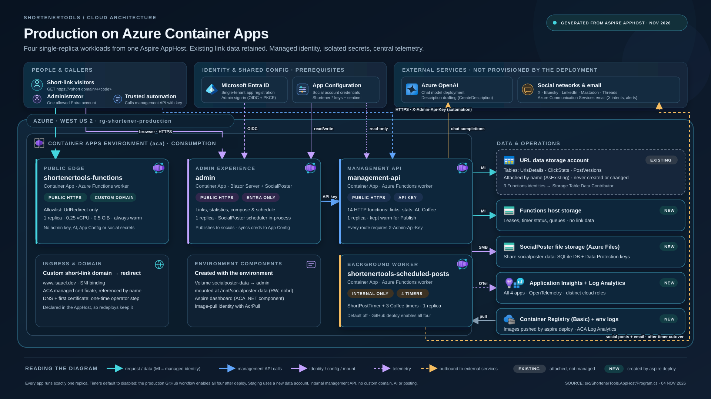
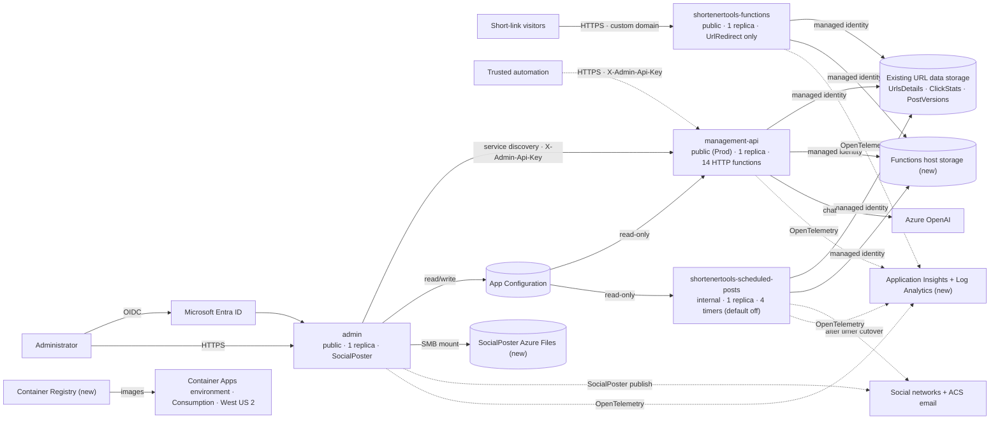

# Production Azure architecture diagram

This is the presentation view of the **Production** deployment that `aspire deploy --environment Production` creates
from `src/ShortenerTools.AppHost/Program.cs` (updated November 4, 2026). The SVG is 1920 × 1080 and can be dropped into
slides as a vector graphic.

For the full resource inventory see [Azure resources](azure-resources.md); for request flows and security boundaries see
[Architecture](architecture.md).

## What the diagram shows

**Top row: outside the deployment.**

| Box                          | Notes                                                                                                         |
|------------------------------|---------------------------------------------------------------------------------------------------------------|
| People & callers             | Short-link visitors, the single administrator, and trusted automation that calls the management API with the API key. |
| Microsoft Entra ID           | Single-tenant app registration used for admin sign-in (authorization code + PKCE). Prerequisite.              |
| App Configuration            | Holds the social account credentials (`Shortener:*` keys + sentinel). Admin writes with a read/write key; Functions read with a read-only key. Prerequisite. |
| Azure OpenAI                 | Chat model used by `CreateDescription` in the management API. Prerequisite.                                  |
| Social networks & email      | X, Bluesky, LinkedIn, Mastodon, Threads, and Azure Communication Services email (X intent links, failure alerts). |

**Azure scope: resource group `rg-shortener-production`, West US 2.**

| Box                                | Status   | Notes                                                                                                            |
|------------------------------------|----------|------------------------------------------------------------------------------------------------------------------|
| Container Apps environment `aca`   | New      | Consumption; shared ingress for the four apps.                                                                   |
| `shortenertools-functions`         | New      | Public HTTPS + custom domain; only `UrlRedirect`; 1 replica, 0.25 vCPU / 0.5 GiB; no admin, AI, config or social secrets. |
| `admin`                            | New      | Public HTTPS; Entra-only; Blazor Server + SocialPoster; 1 replica (SocialPoster's scheduler runs in-process).     |
| `management-api`                   | New      | Public HTTPS in Production; every route needs `X-Admin-Api-Key`; 14 HTTP functions; 1 replica kept warm.         |
| `shortenertools-scheduled-posts`   | New      | Internal only; `ShortPostTimer` + three Coffee timers; 1 replica; independent default-off gates.                |
| Ingress & domain                   | Operator + AppHost | `www.isaacl.dev` bound to the redirect app with an ACA managed certificate, referenced by name so redeploys keep it. DNS and the first certificate are one-time manual steps. |
| Environment components             | New      | Azure Files volume `socialposter-data` mounted into admin at `/mnt/socialposter-data`; Aspire dashboard; image-pull identity with AcrPull. |
| URL data storage account           | Existing | `UrlsDetails`, `ClickStats`, `PostVersions`. Attached by name (`AsExisting`); the three Functions identities get Storage Table Data Contributor. Never created or modified by the deployment. |
| Functions host storage             | New      | Functions runtime leases, timer status and queues; no link data.                                                 |
| SocialPoster file storage          | New      | Azure Files share holding the SocialPoster SQLite database and Data Protection keys.                           |
| Application Insights + Log Analytics | New    | Workspace-based; all four apps export OpenTelemetry with distinct `cloud_RoleName`s.                            |
| Container Registry (Basic) + env logs | New   | Images pushed by `aspire deploy`; the environment's own Log Analytics workspace.                                 |

**Line styles**

| Style                 | Meaning                                                                                        |
|-----------------------|------------------------------------------------------------------------------------------------|
| Solid cyan            | Requests and data access (`MI` = managed identity)                                             |
| Solid / dashed blue   | Management API calls (admin server-side; automation over public HTTPS)                         |
| Purple                | Identity (OIDC), App Configuration access, and the Azure Files (SMB) mount                     |
| Dashed purple         | Telemetry (OpenTelemetry → Application Insights)                                               |
| Amber                 | Outbound calls to Azure OpenAI and, after the timer cutover, to social networks and email     |
| Dashed grey border    | Existing resource (attached, not managed)                                                      |

Things worth knowing that the picture compresses:

- Every app runs exactly one replica. Timers default to disabled; the production GitHub workflow enables all four after
  every deploy, while the helper script only enables them with `-EnableScheduler` / `-EnableCoffeeScheduler`.
- All posting goes through SocialPoster: the admin (Publish/Schedule) uses SocialPoster's own account store, and the
  Functions apps (timers, Coffee, manual endpoints) use the same SocialPoster clients with credentials synced to App
  Configuration. See [Social posting](architecture.md#social-posting-socialposter).
- Staging uses the same shape with a new data account, an internal management API, no custom domain, no AI and no
  posting. See [Staging differences](azure-resources.md#staging-differences).

## Mermaid source

The same topology in an editable form:

## Updating the diagram

The SVG is hand-authored (no build step). When the AppHost changes ingress, replicas, function allowlists, resources or
role assignments, update the matching card text and this page together, and change the date in the footer
(`SOURCE: … · <date>`). `src/tools/Test-AcaArtifacts.ps1` asserts most of the facts shown, so a passing CI run is a good
cross-check.

## Icon sources

The Azure service marks are embedded unchanged from Microsoft's official
[Azure Architecture Icons](https://learn.microsoft.com/azure/architecture/icons/) (V24): Container Apps Environment,
Worker Container App, Azure OpenAI, Table, Storage Accounts, Application Insights, Log Analytics Workspaces and Container
Registries, used under the [icon terms](https://learn.microsoft.com/azure/architecture/icons/#icon-terms). The Microsoft
Entra ID logo comes from the official
[Microsoft Entra architecture icon set](https://learn.microsoft.com/entra/architecture/architecture-icons), under its
[icon terms](https://learn.microsoft.com/entra/architecture/architecture-icons#icon-terms). Service names are shown
alongside each mark.

The App Configuration, social/email, people, domain and environment-component glyphs are simple drawn shapes, not
official icons.
