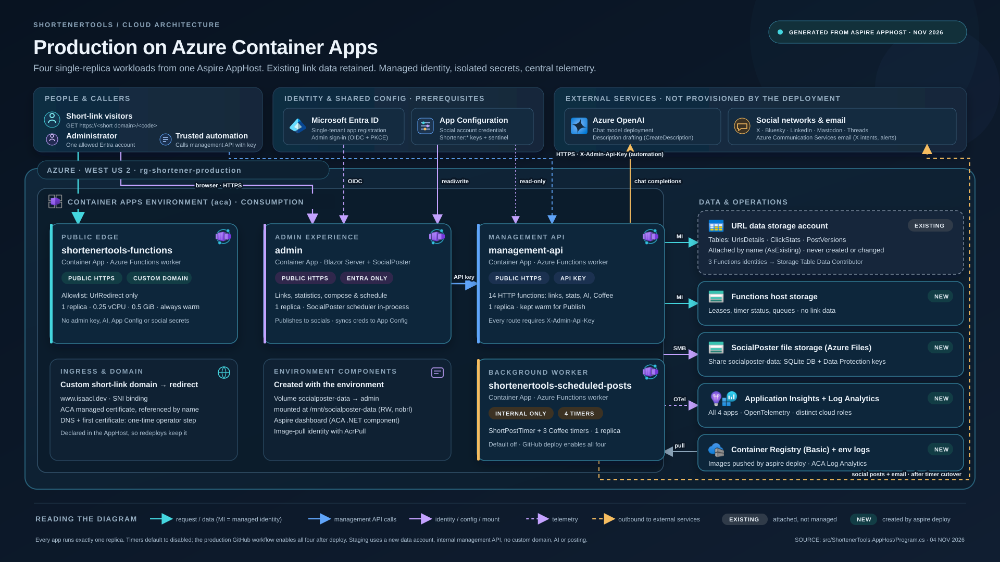

# What gets created in Azure

This is the complete inventory of Azure resources involved in a ShortenerTools deployment: what `aspire deploy` creates,
what it only *references*, and what you must set up yourself beforehand.



Everything below is derived from `src/ShortenerTools.AppHost/Program.cs`. Aspire turns that file into Bicep; nothing is
hand-written. To see the exact templates for your version, generate them without touching Azure:

```powershell
aspire publish --apphost src\ShortenerTools.AppHost\ShortenerTools.AppHost.csproj `
    --environment Production --non-interactive -o .\aspire-output
```

`aspire-output/main.bicep` is the entry point; each resource has its own folder/module.

- [Deployment scope](#deployment-scope)
- [At a glance](#at-a-glance)
- [Created by the deployment](#created-by-the-deployment)
  - [Container Apps environment (`aca`)](#1-container-apps-environment-aca)
  - [SocialPoster file storage](#2-socialposter-file-storage-added-by-the-apphost)
  - [Functions host storage (`functions-host`)](#3-functions-host-storage-functions-host)
  - [Application Insights (`app-insights`)](#4-application-insights-app-insights)
  - [The four Container Apps](#5-the-four-container-apps)
  - [Managed identities and role assignments](#6-managed-identities-and-role-assignments)
- [Referenced but not created](#referenced-but-not-created)
- [Prerequisites you create yourself](#prerequisites-you-create-yourself)
- [Staging differences](#staging-differences)
- [Changes made after deployment](#changes-made-after-deployment)
- [Naming and finding resources](#naming-and-finding-resources)
- [Cost overview](#cost-overview)

## Deployment scope

- `main.bicep` is **subscription-scoped**. It declares the target resource group (`Azure__ResourceGroup`, in
  `Azure__Location`) and deploys every module into it.
- The only cross-resource-group writes are **role assignments on the existing URL data storage account**, which go into
  that account's own resource group (`existing-storage-resource-group`).
- One AppHost environment per resource group. Application Insights and other names are derived from the resource group,
  so deploying Production and Staging into the same group would make them share resources. Don't.

## At a glance

| # | Resource                                          | Type (`Microsoft.*`)                                  | Production | Staging | Local      |
|---|---------------------------------------------------|-------------------------------------------------------|------------|---------|------------|
| 1 | Resource group                                    | `Resources/resourceGroups`                            | Created/updated | Created/updated | — |
| 2 | Container Apps managed environment (Consumption)  | `App/managedEnvironments`                             | New        | New     | —          |
| 3 | Log Analytics workspace (for the ACA environment) | `OperationalInsights/workspaces`                      | New        | New     | —          |
| 4 | Azure Container Registry (Basic)                  | `ContainerRegistry/registries`                        | New        | New     | —          |
| 5 | User-assigned identity for image pulls (+ AcrPull) | `ManagedIdentity/userAssignedIdentities`             | New        | New     | —          |
| 6 | Aspire dashboard component                        | `App/managedEnvironments/dotNetComponents`            | New        | New     | Local dashboard |
| 7 | SocialPoster storage account + file share + env storage mount | `Storage/storageAccounts`, `.../fileServices/shares`, `App/managedEnvironments/storages` | New | New | Local folder |
| 8 | Functions host storage account                    | `Storage/storageAccounts`                             | New        | New     | Azurite    |
| 9 | Application Insights + its Log Analytics workspace | `Insights/components`, `OperationalInsights/workspaces` | New      | New     | —          |
| 10 | Container App `shortenertools-functions`         | `App/containerApps`                                   | New        | New     | Process    |
| 11 | Container App `management-api`                   | `App/containerApps`                                   | New        | New     | Process    |
| 12 | Container App `shortenertools-scheduled-posts`   | `App/containerApps`                                   | New        | New     | Process    |
| 13 | Container App `admin`                            | `App/containerApps`                                   | New        | New     | Process    |
| 14 | Per-app user-assigned identities (Functions apps) | `ManagedIdentity/userAssignedIdentities`             | New        | New     | —          |
| 15 | Role assignments                                  | `Authorization/roleAssignments`                       | New        | New     | —          |
| 16 | URL data storage account (tables)                 | `Storage/storageAccounts`                             | **Existing (referenced)** | **New** | Azurite or live |
| — | Entra app registration, App Configuration, Azure OpenAI, Communication Services, Cloudflare DNS + uploaded Origin CA certificate, deployment identity | various | **Prerequisites** | Entra + App Configuration | Entra (+ optional) |

"New" means created on first deploy and updated in place on later deploys.

## Created by the deployment

### 1. Container Apps environment (`aca`)

Declared by `builder.AddAzureContainerAppEnvironment("aca")`. Aspire's default module for an ACA environment creates:

| Resource                               | Notes                                                                                                                        |
|----------------------------------------|------------------------------------------------------------------------------------------------------------------------------|
| Container Apps managed environment     | Consumption workload profile. All four apps share it, along with its default domain (`<name>.<region>.azurecontainerapps.io`). |
| Log Analytics workspace                | Receives container console/system logs for the environment.                                                                  |
| Azure Container Registry (Basic SKU)   | `aspire deploy` builds the Admin and Functions images and pushes them here.                                                  |
| User-assigned managed identity         | Granted **AcrPull** on the registry; Container Apps use it to pull images.                                                   |
| Aspire dashboard (ACA .NET component)  | The Aspire dashboard hosted in the environment.                                                                              |
| Role assignment for the deploying principal | Aspire grants the deploying identity access to the environment (used for the dashboard).                              |

See the Aspire docs on [configuring Container Apps environments](https://aspire.dev/integrations/cloud/azure/configure-container-apps)
for the module's details.

### 2. SocialPoster file storage (added by the AppHost)

Only in publish/deploy mode, the AppHost customises the `aca` module (`aca.ConfigureInfrastructure(...)`) to give the
admin app a persistent disk, because container filesystems are replaced on every revision:

| Resource                                       | Configuration                                                                                                             |
|------------------------------------------------|---------------------------------------------------------------------------------------------------------------------------|
| Storage account `socialposter<uniqueString(rg)>` (truncated to 24 chars) | StorageV2, **Standard_LRS**, TLS 1.2 minimum, blob public access **off**, shared-key access **on** (ACA mounts Azure Files with the account key). |
| File service + file share `socialposter-data`   | Holds the SocialPoster SQLite database, uploaded media and Data Protection keys.                                         |
| Environment storage `socialposter-data`         | Registers the share with the ACA environment, **ReadWrite**, using `listKeys().keys[0].value`.                          |

The `admin` Container App mounts it as volume `socialposter-data` at `/mnt/socialposter-data` with mount options
`nobrl,dir_mode=0777,file_mode=0666,uid=0,gid=0` (`nobrl` because SQLite byte-range locks don't work over SMB; safe
because there is exactly one writer). `SocialPoster__DataDirectory` points at the mount.

> [!IMPORTANT]
> This share is the only copy of SocialPoster accounts, schedules and history, and its `keys/` folder is needed to
> decrypt them. Back it up; see [Operations → SocialPoster data](operations.md#backing-up-socialposter-data).

### 3. Functions host storage (`functions-host`)

`builder.AddAzureStorage("functions-host")`, attached to all three Functions apps with `WithHostStorage`. It is a **new**
Storage account used only by the Azure Functions runtime: blob leases, timer schedule status, internal queues. It holds no
link or click data. Functions access it with managed identity (see role assignments).

### 4. Application Insights (`app-insights`)

`builder.AddAzureApplicationInsights("app-insights")` — publish/deploy only.

| Resource                                       | Configuration                                                         |
|------------------------------------------------|-----------------------------------------------------------------------|
| Application Insights component                 | Workspace-based; tagged `aspire-resource-name=app-insights`.          |
| Log Analytics workspace                        | `PerGB2018` (pay-as-you-go). Separate from the ACA environment's workspace. |

All four apps receive `APPLICATIONINSIGHTS_CONNECTION_STRING` from the module's output (no secret to manage).
`Test-AcaArtifacts.ps1` asserts this wiring.

### 5. The four Container Apps

| Setting                    | `shortenertools-functions`          | `management-api`                                  | `shortenertools-scheduled-posts`      | `admin`                                       |
|----------------------------|-------------------------------------|---------------------------------------------------|---------------------------------------|-----------------------------------------------|
| Image                      | Functions project                   | Functions project                                 | Functions project                     | Admin project                                 |
| Ingress                    | **External** HTTPS                  | **External** in Production, internal in Staging   | **Internal only**                     | **External** HTTPS                            |
| Custom domain              | Production: `redirect-domain-name` + uploaded cert `redirect-certificate-name` (SNI) | — | — | —                                       |
| Replicas (min/max)         | 1 / 1                               | 1 / 1                                             | 1 / 1                                 | 1 / 1                                         |
| CPU / memory               | **0.25 vCPU / 0.5 GiB**             | Aspire default                                    | Aspire default                        | Aspire default                                |
| Functions enabled          | `UrlRedirect`                       | 14 HTTP functions                                 | 4 timer functions                     | n/a                                           |
| Host ID                    | `shortener-redirect`                | `shortener-management`                            | `shortener-scheduler`                 | n/a                                           |
| Managed identity           | Own user-assigned identity          | Own user-assigned identity                        | Own user-assigned identity            | None needed (share is mounted by the environment) |
| Volumes                    | —                                   | —                                                 | —                                     | Azure Files `socialposter-data` → `/mnt/socialposter-data` |
| Secrets (Container App secrets, referenced via `secretRef`) | — | `AdminApiKey`, `ConnectionStrings__chat`, `ConnectionStrings__social-accounts` (read-only), `COMMUNICATION_SERVICES_CONNECTION_STRING`, `EmailFrom`, `EmailTo` | `ConnectionStrings__social-accounts` (read-only), `COMMUNICATION_SERVICES_CONNECTION_STRING`, `EmailFrom`, `EmailTo` | `Entra__ClientSecret`, `AdminApiKey`, `ConnectionStrings__social-accounts` (read/write) |
| Notable plain settings     | `DefaultRedirectUrl`, `tables__tableServiceUri`, `EnableDescriptionGeneration=false` | `CustomDomain`, `DeploymentName`, `PostSocials`, `EnableDescriptionGeneration`, `DisableExternalPosting` | `CustomDomain`, `AzureWebJobs.<timer>.Disabled` (×4), `PostSocials`, `DisableExternalPosting` | `Entra__TenantId`, `Entra__ClientId`, `Entra__AdministratorObjectId`, `ASPNETCORE_FORWARDEDHEADERS_ENABLED=true`, `services__management-api__*` |

Why everything has exactly one replica:

- **Redirect** — always warm, no cold start for visitors; tiny allocation keeps it cheap.
- **Management API** — the admin's Publish button calls it interactively; a ~20 s cold start stalled publishing.
- **Scheduler** — a Functions timer listener must be running to fire; also guarantees no duplicate timer execution.
- **Admin** — SocialPoster's SQLite store must have a single writer, and its scheduling worker must keep polling.

The full list of environment variables per app is in the [Configuration reference](configuration.md#settings-each-app-receives).

### 6. Managed identities and role assignments

Each Functions app gets its own user-assigned managed identity. The Functions code uses `DefaultAzureCredential`, which
Aspire points at that identity (`AZURE_CLIENT_ID`).

| Identity                         | Scope                                     | Role                                  | Why                                                        |
|----------------------------------|-------------------------------------------|---------------------------------------|------------------------------------------------------------|
| each of the 3 Functions apps     | Functions host storage account            | Storage Blob Data Contributor         | Host leases, timer status                                  |
| each of the 3 Functions apps     | Functions host storage account            | Storage Queue Data Contributor        | Runtime queues                                             |
| each of the 3 Functions apps     | Functions host storage account            | Storage Account Contributor           | Runtime management operations on the host account         |
| each of the 3 Functions apps     | **URL data storage account** (existing in Production) | Storage Table Data Contributor | Read/write `UrlsDetails`, `ClickStats`, `PostVersions`; create tables on first use |
| ACA pull identity                | Container Registry                        | AcrPull                               | Pull application images                                   |

The data-account assignments are created in that account's resource group, which is why the deployment identity needs
role-assignment rights there too (see [Deployment → deployment identity](deployment.md#4-create-the-deployment-identity-github-oidc)).

## Referenced but not created

### URL data storage account (Production)

```csharp
storage.AsExisting(existingStorageName, existingStorageResourceGroup);   // parameters
var tables = storage.AddTables("tables");
```

- Supplied with `existing-storage-account` and `existing-storage-resource-group`.
- The deployment **does not create, modify or delete** the account or its data. It only adds role assignments and passes
  the table endpoint to the Functions apps as `tables__tableServiceUri`.
- Tables (`UrlsDetails`, `ClickStats`, `PostVersions`) are created by the application on first access if missing.
- `Invoke-ProductionDeployment.ps1 -Mode Deploy` checks the account exists and is visible (`az storage account show`)
  before deploying.

## Prerequisites you create yourself

These are required inputs but are **not** provisioned by Aspire. Setup steps are in [Deployment](deployment.md#one-time-setup).

| Prerequisite                                  | Used by                                     | Provided as                                                                         |
|-----------------------------------------------|---------------------------------------------|-------------------------------------------------------------------------------------|
| Resource group for the deployment             | Everything                                  | `Azure__ResourceGroup`, `Azure__Location` (create it first if your deployment identity lacks subscription-level write) |
| URL data Storage account                      | Functions apps                              | `existing-storage-account`, `existing-storage-resource-group`                      |
| Microsoft Entra app registration (Web, single tenant) | admin sign-in                        | `entra-tenant-id`, `entra-client-id`, `entra-client-secret`, `administrator-object-id` |
| Azure App Configuration store                 | admin (read/write), Functions (read-only)   | `social-accounts-connection-string`, `social-accounts-readonly-connection-string`   |
| Azure OpenAI resource + model deployment      | management-api (`CreateDescription`)        | `ConnectionStrings__chat`, `azure-openai-deployment-name`                           |
| Azure Communication Services (Email) + verified sender domain | X-intent and error emails    | `communication-services-connection-string`, `email-from`, `email-to`               |
| Cloudflare DNS + uploaded Origin CA cert      | Redirect custom domain                      | `custom-domain` (URL), `redirect-certificate-name`                                 |
| Deployment identity (GitHub OIDC) + roles     | GitHub Actions deploy job                   | `AZURE_CLIENT_ID`, `AZURE_TENANT_ID`, `AZURE_SUBSCRIPTION_ID`                       |
| A strong random API key                       | admin ↔ management-api                      | `admin-api-key`                                                                     |

Social provider credentials for X, Bluesky, LinkedIn, Mastodon and Threads are **not** deployment inputs: you enter them
in the SocialPoster *Settings* page after deployment, and the admin mirrors them into App Configuration. The optional X
"via" handle is also an App Configuration key (`Shortener:TwitterViaHandle`), set directly in the store.

## Staging differences

`--environment Staging` produces a deliberately inert copy:

| Area                          | Staging behaviour                                                                                         |
|-------------------------------|-----------------------------------------------------------------------------------------------------------|
| URL data storage              | A **new** Storage account (`storage`) is created in the staging resource group; production data is never attached. |
| Management API                | Internal ingress only.                                                                                    |
| Custom domain                 | None. `custom-domain` and `default-redirect-url` default to `https://shortener.staging.invalid` / `https://redirect.staging.invalid`. |
| AI                            | Not configured; no `ConnectionStrings__chat`; `EnableDescriptionGeneration=false`.                        |
| Social/email secrets          | ACS and email parameters are not declared, so nothing is passed in.                     |
| App Configuration             | **Still required.** Admin gets the read/write string, Functions the read-only one. Use a **separate staging store** — a staging admin pointed at the production store with a read/write key would overwrite production credentials. |
| Timers                        | Hard-coded `true` for all `AzureWebJobs.*.Disabled` settings, ignoring any cutover input.                 |
| Posting                       | `DisableExternalPosting=True`, `PostSocials=False` on the management API and scheduler (the redirect app never posts). |
| Everything else               | Same: ACA environment, registry, SocialPoster share, host storage, Application Insights, four apps.       |

`Test-AcaArtifacts.ps1 -DeploymentEnvironment Staging` asserts all of the above.

## Changes made after deployment

The production GitHub workflow runs one extra command after `aspire deploy`:

```bash
az containerapp update --name shortenertools-scheduled-posts --resource-group <rg> \
  --set-env-vars AzureWebJobs.ShortPostTimer.Disabled=false AzureWebJobs.COSSTeaserTimer.Disabled=false \
                 AzureWebJobs.COSSAnnouncementTimer.Disabled=false AzureWebJobs.COSSArchiveTimer.Disabled=false
```

This creates a new revision of the scheduler with all four timers enabled, then reads the values back and fails the job
if any is not `false`. It exists because Aspire module parameters have been observed to resolve to their disabled
defaults even when the enable switches were passed.

Nothing else outside the AppHost model is modified by the tooling. In particular, **DNS is never changed**.

## Naming and finding resources

- Container Apps keep their logical names: `admin`, `management-api`, `shortenertools-functions`,
  `shortenertools-scheduled-posts`.
- Other resources get Aspire-generated names (logical name + a `uniqueString` of the resource group) and an
  `aspire-resource-name` tag with the logical name.

```powershell
$rg = '<resource-group>'
az resource list -g $rg --query "[].{name:name, type:type, aspire:tags.\"aspire-resource-name\"}" -o table
az containerapp list -g $rg --query "[].{name:name, fqdn:properties.configuration.ingress.fqdn, external:properties.configuration.ingress.external}" -o table
```

## Cost overview

All four apps are always on (min replicas = 1), so expect a baseline even with no traffic. Billable items:

- **Container Apps (Consumption):** four warm replicas. The redirect alone (0.25 vCPU / 0.5 GiB) is roughly
  $6/month at illustrative US idle rates before free grants; the others use larger default allocations. ACA monthly
  grants (180,000 vCPU-s, 360,000 GiB-s, 2M requests) are shared per subscription.
- **Container Registry (Basic)**, **two Log Analytics workspaces** + **Application Insights** ingestion/retention.
- **Storage:** host account, SocialPoster file share, existing data account transactions.
- **External services:** Azure OpenAI tokens, App Configuration tier (sync polls every 5 s; the Developer tier has low
  request quotas), Communication Services email.

Check [ACA pricing](https://azure.microsoft.com/pricing/details/container-apps/) and
[Azure Monitor pricing](https://azure.microsoft.com/pricing/details/monitor/) for your region, and consider a daily cap
on the Application Insights workspace.
