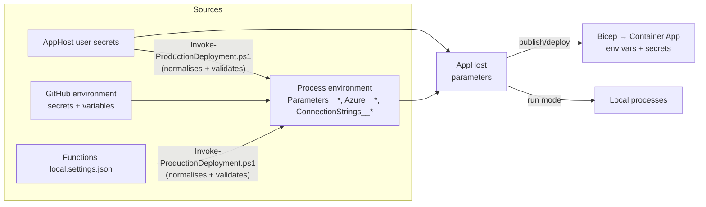

# Configuration reference

Every knob in ShortenerTools, where it is set, and where it ends up.

- [How configuration flows](#how-configuration-flows)
- [Naming: config keys vs. environment variables](#naming-config-keys-vs-environment-variables)
- [AppHost parameters](#apphost-parameters)
- [Connection strings](#connection-strings)
- [Azure target settings](#azure-target-settings)
- [AppHost switches (local runs)](#apphost-switches-local-runs)
- [GitHub environment → parameter mapping](#github-environment--parameter-mapping)
- [Deployment helper input sources](#deployment-helper-input-sources)
- [Settings each app receives](#settings-each-app-receives)
- [Feature guards](#feature-guards)
- [Social provider credentials (App Configuration)](#social-provider-credentials-app-configuration)
- [Example user-secrets file](#example-user-secrets-file)

## How configuration flows



The AppHost declares **parameters**; the apps never read user secrets or GitHub directly. Aspire resolves each parameter
from .NET configuration (user secrets, `appsettings*.json`, environment variables) and injects the value into the target
app as an environment variable — as a Container App **secret** if the parameter is marked secret.

## Naming: config keys vs. environment variables

| Form                    | Example                                 | Who understands it                                              |
|-------------------------|-----------------------------------------|-----------------------------------------------------------------|
| Config key              | `Parameters:entra-tenant-id`            | User secrets, `appsettings.json`                                |
| Exact env var           | `Parameters__entra-tenant-id`           | Aspire / .NET configuration                                     |
| Portable env var        | `Parameters__entra_tenant_id`           | Aspire (a single `_` in the variable name stands for a `-` in the parameter name) and `Invoke-ProductionDeployment.ps1` |

The portable form exists because most shells can't `export` a name containing `-`. Use one form per parameter. The helper
reads either form and writes the exact form; for the timer gates and `redirect-domain-name` it writes **both** forms with
the same value, so an inherited variable in the other spelling can't override the cutover decision.
See [Aspire external parameters](https://aspire.dev/fundamentals/external-parameters/).

## AppHost parameters

"Prod" = `aspire publish/deploy --environment Production`; "Staging" = `--environment Staging`; "Local" = `aspire start`.
✅ required · ⚪ optional/defaulted · — not declared.

| Parameter                                    | Secret | Local | Staging | Prod | Purpose and destination                                                                                                         |
|----------------------------------------------|:------:|:-----:|:-------:|:----:|---------------------------------------------------------------------------------------------------------------------------------|
| `entra-tenant-id`                            |        | ✅    | ✅      | ✅   | Entra tenant GUID → admin `Entra__TenantId`. Also the tenant whose users are allowed.                                          |
| `entra-client-id`                            |        | ✅    | ✅      | ✅   | App registration (client) ID → admin `Entra__ClientId`.                                                                        |
| `entra-client-secret`                        | 🔒     | ✅    | ✅      | ✅   | Client secret **value** → admin `Entra__ClientSecret`.                                                                         |
| `administrator-object-id`                    |        | ✅    | ✅      | ✅   | Object ID (in that tenant) of the only allowed user → admin `Entra__AdministratorObjectId`.                                    |
| `admin-api-key`                              | 🔒     | ✅    | ✅      | ✅   | Shared secret → admin and management-api `AdminApiKey`. Callers send it as `X-Admin-Api-Key`.                                  |
| `custom-domain`                              |        | ✅    | ⚪ `https://shortener.staging.invalid` | ✅ | Short-link **origin** (`https://host`, no trailing slash/path/port) → management-api and scheduler `CustomDomain`, used to build short URLs. In Production the helper also derives `redirect-domain-name` from it. |
| `default-redirect-url`                       |        | ✅    | ⚪ `https://redirect.staging.invalid`  | ✅ | Where unknown/archived codes go → redirect app `DefaultRedirectUrl`.                                                |
| `redirect-domain-name`                       |        | —     | —       | ✅   | Bare hostname (e.g. `www.example.com`) bound on the redirect app's ingress. The helper derives it from `custom-domain`.        |
| `redirect-certificate-name`                  |        | —     | —       | ✅   | **Name** (not resource ID) of an existing certificate uploaded to the ACA environment (the Cloudflare Origin CA certificate; ACA managed certificates are not supported). Empty → binding disabled (bootstrap only). |
| `existing-storage-account`                   |        | —     | —       | ✅   | Name of the URL data Storage account to attach.                                                                                |
| `existing-storage-resource-group`            |        | —     | —       | ✅   | Its resource group.                                                                                                            |
| `azure-openai-deployment-name`               |        | ⚪ `gpt-4o-mini` | — | ✅ | Model deployment name → management-api `DeploymentName`. Never defaulted in Production.                                        |
| `social-accounts-connection-string`          | 🔒     | ⚪    | ✅      | ✅   | App Configuration **read/write** connection string → admin `ConnectionStrings__social-accounts`. Locally, omit to disable sync. |
| `social-accounts-readonly-connection-string` | 🔒     | ⚪    | ✅      | ✅   | App Configuration **read-only** connection string → management-api and scheduler `ConnectionStrings__social-accounts`.        |
| `communication-services-connection-string`   | 🔒     | —     | —       | ✅   | Azure Communication Services → `COMMUNICATION_SERVICES_CONNECTION_STRING`.                                                     |
| `email-from`                                 | 🔒     | —     | —       | ✅   | Verified ACS sender address → `EmailFrom`.                                                                                     |
| `email-to`                                   | 🔒     | —     | —       | ✅   | Where X-intent and error emails go → `EmailTo`.                                                                                |
| `scheduler-disabled`                         |        | ⚪    | ⚪      | ⚪ `true` | Production only: value of `AzureWebJobs.ShortPostTimer.Disabled` on the scheduler (module parameter `scheduler_disabled_value`). |
| `coffee-scheduler-disabled`                  |        | ⚪    | ⚪      | ⚪ `true` | Production only: value of the three `AzureWebJobs.COSS*Timer.Disabled` settings (module parameter `coffee_scheduler_disabled_value`). |

When a required parameter has no value, `aspire start` prompts for it in the dashboard; `aspire publish` emits a Bicep
parameter; `aspire deploy --non-interactive` fails. The helper script fails earlier, with a list of what's missing.

## Connection strings

| Name                 | Where                       | Format                                                                 | Notes                                                                                                         |
|----------------------|-----------------------------|------------------------------------------------------------------------|---------------------------------------------------------------------------------------------------------------|
| `chat`               | Prod; Local when `Ollama:UseLocalModel=false` | `Endpoint=https://<resource>.openai.azure.com/;Key=<key>`               | Azure OpenAI. Becomes the management-api secret `ConnectionStrings__chat`. Endpoint-only also validates, but then you must grant the management-api identity an OpenAI data-plane role yourself. |
| `production-data`    | Local only, with `Storage:UseProduction=true` | Storage connection string of the URL data account     | Lets local apps read/write **live** tables. Never used in Azure.                                              |
| `tables`             | Generated by Aspire         | —                                                                      | Azurite locally; in Azure the apps get `tables__tableServiceUri` and use managed identity.                     |

## Azure target settings

Read by `aspire deploy` (and validated by the helper):

| Setting                | Config key              | Env var                  | GitHub source                    |
|------------------------|-------------------------|--------------------------|----------------------------------|
| Subscription           | `Azure:SubscriptionId`  | `Azure__SubscriptionId`  | secret `AZURE_SUBSCRIPTION_ID`   |
| Region                 | `Azure:Location`        | `Azure__Location`        | variable `AZURE_LOCATION`        |
| Resource group         | `Azure:ResourceGroup`   | `Azure__ResourceGroup`   | variable `AZURE_RESOURCE_GROUP`  |

With `-LoadUserSecrets`, the helper also falls back to `ProductionDeployment:SubscriptionId|Location|ResourceGroup`.

## AppHost switches (local runs)

Set in AppHost user secrets or `appsettings.Development.json`. They have no effect on publish/deploy.

| Key                     | Default | Effect                                                                                                    |
|-------------------------|---------|-----------------------------------------------------------------------------------------------------------|
| `Ollama:UseLocalModel`  | `true`  | Run Ollama (+ Open WebUI) in Docker with `llama3` for `CreateDescription`. `false` → use `ConnectionStrings:chat`. |
| `Ollama:UseGpu`         | `false` | Pass `--gpus=all` to the Ollama container.                                                                |
| `Storage:UseProduction` | `false` | Point redirect + management API at `ConnectionStrings:production-data` (live data). Scheduler stays on Azurite. The `https-production-data` launch profile sets this for you. |

## GitHub environment → parameter mapping

Configured on the GitHub **environment** named `production`. The deploy job exports these into the environment variables
shown, and the helper normalises them.

| GitHub name                                          | Kind     | Exported as                                             | Parameter                                    |
|------------------------------------------------------|----------|---------------------------------------------------------|----------------------------------------------|
| `AZURE_CLIENT_ID`                                    | secret   | (used by `azure/login`)                                 | — deployment identity                        |
| `AZURE_TENANT_ID`                                    | secret   | `Parameters__entra_tenant_id` (+ `azure/login`)         | `entra-tenant-id`                            |
| `AZURE_SUBSCRIPTION_ID`                              | secret   | `Azure__SubscriptionId` (+ `azure/login`)               | —                                            |
| `AZURE_LOCATION`                                     | variable | `Azure__Location`                                       | —                                            |
| `AZURE_RESOURCE_GROUP`                               | variable | `Azure__ResourceGroup`                                  | —                                            |
| `EXISTING_STORAGE_ACCOUNT`                           | variable | `Parameters__existing_storage_account`                  | `existing-storage-account`                   |
| `EXISTING_STORAGE_RESOURCE_GROUP`                    | variable | `Parameters__existing_storage_resource_group`           | `existing-storage-resource-group`            |
| `ENTRA_CLIENT_ID`                                    | variable | `Parameters__entra_client_id`                           | `entra-client-id`                            |
| `ENTRA_CLIENT_SECRET`                                | secret   | `Parameters__entra_client_secret`                       | `entra-client-secret`                        |
| `ADMINISTRATOR_OBJECT_ID`                            | variable | `Parameters__administrator_object_id`                   | `administrator-object-id`                    |
| `ADMIN_API_KEY`                                      | secret   | `Parameters__admin_api_key`                             | `admin-api-key`                              |
| `SHORT_LINK_DOMAIN`                                  | variable | `Parameters__custom_domain`                             | `custom-domain` (+ derived `redirect-domain-name`) |
| `REDIRECT_CERTIFICATE_NAME`                          | variable | `Parameters__redirect_certificate_name`                 | `redirect-certificate-name`                  |
| `DEFAULT_REDIRECT_URL`                               | variable | `Parameters__default_redirect_url`                      | `default-redirect-url`                       |
| `SOCIAL_ACCOUNTS_CONFIG_READWRITE_CONNECTION_STRING` | secret   | `Parameters__social_accounts_connection_string`         | `social-accounts-connection-string`          |
| `SOCIAL_ACCOUNTS_CONFIG_READONLY_CONNECTION_STRING`  | secret   | `Parameters__social_accounts_readonly_connection_string`| `social-accounts-readonly-connection-string` |
| `COMMUNICATION_SERVICES_CONNECTION_STRING`           | secret   | `Parameters__communication_services_connection_string`  | `communication-services-connection-string`   |
| `EMAIL_FROM`                                         | secret   | `Parameters__email_from`                                | `email-from`                                 |
| `EMAIL_TO`                                           | secret   | `Parameters__email_to`                                  | `email-to`                                   |
| `AZURE_OPENAI_CONNECTION_STRING`                     | secret   | `ConnectionStrings__chat`                               | connection string `chat`                     |
| `AZURE_OPENAI_DEPLOYMENT_NAME`                       | variable | `Parameters__azure_openai_deployment_name`              | `azure-openai-deployment-name`               |

Note that `AZURE_TENANT_ID` is used both to log in the deployment identity and as the admin's Entra tenant, so both must
live in the same tenant. `AZURE_CLIENT_ID` (deployment identity) is **not** `ENTRA_CLIENT_ID` (admin sign-in app).

## Deployment helper input sources

`Invoke-ProductionDeployment.ps1` resolves every parameter from the first non-blank source, in this order:

1. Exact process env var `Parameters__<name>` (dashed).
2. Portable process env var `Parameters__<name_with_underscores>`.
3. *(only for the five production-default keys below, and only with `-LoadUserSecrets`)* user secret
   `ProductionDeployment:<Key>`.
4. AppHost user secret `Parameters:<name>` (with `-LoadUserSecrets`).
5. Functions `local.settings.json` → `Values[<key>]` (with `-LocalSettingsPath`), using this mapping:

| Parameter                                    | `ProductionDeployment:` key (step 3) | Functions `Values` key (step 5)                     |
|----------------------------------------------|--------------------------------------|-----------------------------------------------------|
| `custom-domain`                              | `CustomDomain`                       | `CustomDomain`                                      |
| `redirect-certificate-name`                  | `RedirectCertificateName`            | —                                                   |
| `default-redirect-url`                       | `DefaultRedirectUrl`                 | `DefaultRedirectUrl`                                |
| `existing-storage-account`                   | `ExistingStorageAccount`             | —                                                   |
| `existing-storage-resource-group`            | `ExistingStorageResourceGroup`       | —                                                   |
| `admin-api-key`                              | —                                    | `AdminApiKey`                                       |
| `social-accounts-connection-string`          | —                                    | `ConnectionStrings:social-accounts`                 |
| `social-accounts-readonly-connection-string` | —                                    | `ConnectionStrings:social-accounts-readonly`        |
| `communication-services-connection-string`   | —                                    | `COMMUNICATION_SERVICES_CONNECTION_STRING`          |
| `email-from` / `email-to`                    | —                                    | `EmailFrom` / `EmailTo`                             |
| `azure-openai-deployment-name`               | —                                    | `DeploymentName`                                    |
| `entra-*`, `administrator-object-id`         | —                                    | —                                                   |

The `ProductionDeployment:*` keys exist so you can keep **local** values in `Parameters:*` (e.g. `custom-domain =
https://localhost:5001`) without them leaking into a production deploy.

The `chat` connection string is resolved as: env `ConnectionStrings__chat` → user secret `ConnectionStrings:chat` →
`Values["ConnectionStrings:chat"]` → built from `Values["AzureOpenAIEndpoint"]` + `Values["AzureOpenAIKey"]`.

Keys deliberately **not** imported: `StagingDeployment:*`, `Storage:UseProduction`, `ConnectionStrings:production-data`,
`ProductionDeployment:ClientId|PrincipalId|TenantId`.

## Settings each app receives

Generated by the AppHost. Values in *italics* differ by environment.

### All three Functions apps

| Variable                                      | Value                                                                |
|-----------------------------------------------|----------------------------------------------------------------------|
| `AzureFunctionsJobHost__functions__<n>`       | Allowlist (see [Architecture](architecture.md#one-functions-build-three-apps)) |
| `AzureFunctionsWebHost__hostid`               | `shortener-redirect` / `shortener-management` / `shortener-scheduler` |
| `AzureFunctionsJobHost__telemetryMode`        | `OpenTelemetry`                                                      |
| `OTEL_SERVICE_NAME`                           | The app's resource name                                              |
| `AZURE_FUNCTIONS_ENVIRONMENT`                 | *`Production` / `Staging` / `Development`*                           |
| `IN_ASPIRE`                                   | `true` (use Aspire-provided clients and telemetry only)              |
| `tables__tableServiceUri`                     | Data account table endpoint (Azure); locally `DataStorage` connection string |
| `AzureWebJobsStorage__*`                      | Host storage (identity-based in Azure)                               |
| `APPLICATIONINSIGHTS_CONNECTION_STRING`       | Deployed only                                                        |

### Per app

| Variable                                         | `shortenertools-functions` | `management-api`                         | `shortenertools-scheduled-posts`              |
|--------------------------------------------------|----------------------------|------------------------------------------|-----------------------------------------------|
| `CustomDomain`                                   | —                          | ✅                                        | ✅                                            |
| `DefaultRedirectUrl`                             | ✅                         | —                                        | —                                             |
| `DisableExternalPosting`                         | —                          | *Staging or Local→`True`*                | *Staging→`True`*                              |
| `PostSocials` (Coffee)                           | —                          | *`True` only in Prod deploy*             | *`True` only in Prod deploy*                  |
| `EnableDescriptionGeneration`                    | `false`                    | *`True` except Staging*                  | `false`                                       |
| `USE_OLLAMA`                                     | —                          | *Local default `True`*                   | —                                             |
| `AdminApiKey` 🔒                                 | —                          | ✅                                        | —                                             |
| `ConnectionStrings__chat` 🔒, `DeploymentName`   | —                          | *Not in Staging*                         | —                                             |
| `ConnectionStrings__social-accounts` 🔒          | —                          | read-only                                | read-only                                     |
| `COMMUNICATION_SERVICES_CONNECTION_STRING`, `EmailFrom`, `EmailTo` 🔒 | — | *Prod only* | *Prod only*                    |
| `AzureWebJobs.ShortPostTimer.Disabled`           | `true`                     | `true`                                   | *Prod: `scheduler-disabled`; else `true`*      |
| `AzureWebJobs.COSS{Teaser,Announcement,Archive}Timer.Disabled` | `true`       | `true`                                   | *Prod: `coffee-scheduler-disabled`; else `true`* |

### `admin`

| Variable                                    | Value                                                                  |
|---------------------------------------------|------------------------------------------------------------------------|
| `Entra__TenantId`, `Entra__ClientId`, `Entra__AdministratorObjectId` | From parameters (must be GUIDs, validated at startup) |
| `Entra__ClientSecret` 🔒, `AdminApiKey` 🔒  | From parameters (startup fails if missing)                             |
| `ConnectionStrings__social-accounts` 🔒     | App Configuration **read/write** (optional locally)                    |
| `SocialPoster__DataDirectory`               | `/mnt/socialposter-data` (deployed); local default `./socialposter-data` |
| `ASPNETCORE_FORWARDEDHEADERS_ENABLED`       | `true` (TLS terminates at ACA ingress)                                 |
| `services__management-api__https__0` etc.   | Service discovery for `https+http://management-api`                    |
| `OTEL_SERVICE_NAME`                         | `admin`                                                                |

SocialPoster also binds the `SocialPoster` and `SocialPoster:Scheduling` configuration sections if you add them.

## Feature guards

| Guard                                  | Rule                                                                                                      |
|----------------------------------------|-----------------------------------------------------------------------------------------------------------|
| `ExternalPostingAllowed`               | `!DisableExternalPosting` **and** environment ≠ `Staging`. Every social/email send checks it.             |
| Coffee posting                         | `ExternalPostingAllowed` **and** `PostSocials`. Manual Coffee endpoints return `403` otherwise.           |
| `ShortPostTimer`                       | Runs only if not disabled by `AzureWebJobs.ShortPostTimer.Disabled`, `ExternalPostingAllowed`, and no debugger attached. |
| `ShortPostHttp` (`/api/SchedulePost`)  | Acts only under a debugger or in a **non-Production Aspire** run; then publishes the oldest unposted link with `force`. Note: in a dry run nothing is sent, **but the link is still marked `Posted=true`**. |
| `TestShortUrl`                         | Acts only with a debugger attached and `ExternalPostingAllowed`.                                          |
| `CreateDescription`                    | AI client registered only if `EnableDescriptionGeneration` is true and environment ≠ `Staging`; otherwise `503`. |

## Social provider credentials (App Configuration)

You create one Azure App Configuration store (any tier) and two access keys: **read/write** and **read-only**. The
deployment does not create the store.

The admin publishes these keys (label: none) whenever you change accounts in SocialPoster *Settings*:

| App Configuration key              | Comes from SocialPoster setting |
|------------------------------------|---------------------------------|
| `Shortener:BlueskyUserName`        | Bluesky handle                  |
| `Shortener:BlueskyPassword`        | Bluesky app password            |
| `Shortener:TwitterConsumerKey`     | X consumer key                  |
| `Shortener:TwitterConsumerSecret`  | X consumer secret               |
| `Shortener:TwitterAccessToken`     | X access token                  |
| `Shortener:TwitterAccessSecret`    | X access token secret           |
| `Shortener:LinkedInAccessToken`    | LinkedIn access token           |
| `Shortener:MastodonInstance`       | Mastodon instance (default `fosstodon.org`) |
| `Shortener:MastodonAccessToken`    | Mastodon access token           |
| `Shortener:ThreadsToken`           | Threads access token            |
| `Shortener:ThreadsUserId`          | Threads user ID (saved by SocialPoster when you connect Threads) |
| `SocialPoster:Accounts:Sentinel`   | Bumped on every change          |

One more key is read by the Functions apps but is **not** a SocialPoster setting, so you set it directly in the store.
The admin never writes or deletes it:

| App Configuration key              | Purpose                                                                                       |
|------------------------------------|-----------------------------------------------------------------------------------------------|
| `Shortener:TwitterViaHandle`       | Optional. Your X handle (no `@`), added as `via=` on the X intent links emailed when X API credentials aren't configured. |

```powershell
az appconfig kv set --name <store> --key Shortener:TwitterViaHandle --value <handle-without-@> --yes
# Tell running apps to reload (they only re-read the store when the sentinel changes)
az appconfig kv set --name <store> --key SocialPoster:Accounts:Sentinel --value (Get-Date -Format o) --yes
```

The Functions apps load `Shortener:*` with the prefix trimmed (so they bind straight onto `ShortenerSettings`) and
reload everything when the sentinel changes, checking at most every 5 seconds.

Safety: until the admin has published at least once, it will not overwrite a store with an *entirely empty* set of
accounts (protects against a wiped SQLite volume clearing production credentials). While that guard is active it polls
every 60 seconds instead of 5.

Every social account value lives in App Configuration. The Functions apps hand these values to SocialPoster's posting
clients (see [Social posting](architecture.md#social-posting-socialposter)); the admin's own posts read SocialPoster's
local store directly. Email (Azure Communication Services) and AI credentials are not
social accounts; they remain deployment parameters.

## Example user-secrets file

`%APPDATA%\Microsoft\UserSecrets\b32025b0-98ec-4cbe-8f4e-a49302d9d300\secrets.json` (Windows) or
`~/.microsoft/usersecrets/b32025b0-98ec-4cbe-8f4e-a49302d9d300/secrets.json`. Edit it with
`dotnet user-secrets` or your IDE's *Manage User Secrets*, not by pasting secrets on a command line.

```jsonc
{
  // --- Needed for local runs ---
  "Parameters:entra-tenant-id": "00000000-0000-0000-0000-000000000000",
  "Parameters:entra-client-id": "00000000-0000-0000-0000-000000000000",
  "Parameters:entra-client-secret": "<secret value>",
  "Parameters:administrator-object-id": "00000000-0000-0000-0000-000000000000",
  "Parameters:admin-api-key": "<long random string>",
  "Parameters:custom-domain": "https://localhost:5001",
  "Parameters:default-redirect-url": "https://example.com",

  // --- Optional local extras ---
  // "Parameters:social-accounts-connection-string": "Endpoint=https://<store>.azconfig.io;Id=...;Secret=...",
  // "Parameters:social-accounts-readonly-connection-string": "Endpoint=https://<store>.azconfig.io;Id=...;Secret=...",
  // "ConnectionStrings:production-data": "<URL data storage connection string>",
  // "Ollama:UseGpu": "true",

  // --- Production deploys from this machine (helper with -LoadUserSecrets) ---
  "ProductionDeployment:SubscriptionId": "00000000-0000-0000-0000-000000000000",
  "ProductionDeployment:Location": "westus2",
  "ProductionDeployment:ResourceGroup": "rg-shortener-production",
  "ProductionDeployment:CustomDomain": "https://short.example.com",
  "ProductionDeployment:RedirectCertificateName": "short.example.com-<suffix>",
  "ProductionDeployment:DefaultRedirectUrl": "https://example.com",
  "ProductionDeployment:ExistingStorageAccount": "<data account name>",
  "ProductionDeployment:ExistingStorageResourceGroup": "<data account resource group>",
  "Parameters:existing-storage-account": "<data account name>",
  "Parameters:existing-storage-resource-group": "<data account resource group>",
  "Parameters:communication-services-connection-string": "endpoint=https://<acs>.communication.azure.com/;accesskey=...",
  "Parameters:email-from": "DoNotReply@<verified-domain>",
  "Parameters:email-to": "you@example.com",
  "Parameters:azure-openai-deployment-name": "<deployment>",
  "ConnectionStrings:chat": "Endpoint=https://<resource>.openai.azure.com/;Key=<key>"
}
```
