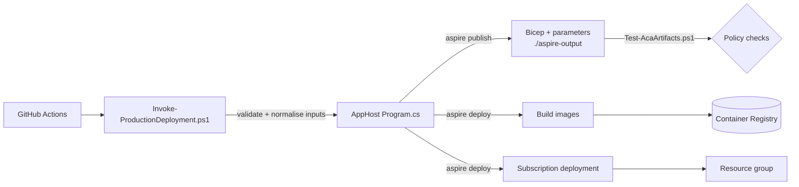

# Deployment guide

How to get ShortenerTools into Azure and keep it updated: one-time setup, the deployment scripts in `src/tools`, the
GitHub Actions workflow, staging, custom domains, and the scheduler cutover.

For *what* gets created, see [Azure resources](azure-resources.md). For every parameter's meaning, see the
[Configuration reference](configuration.md).

- [How deployment works](#how-deployment-works)
- [Tools you need](#tools-you-need)
- [One-time setup](#one-time-setup)
- [Script reference](#script-reference)
  - [`Invoke-ProductionDeployment.ps1`](#invoke-productiondeploymentps1)
  - [`Test-AcaArtifacts.ps1`](#test-acaartifactsps1)
  - [`Test-ProductionDeployment.ps1`](#test-productiondeploymentps1)
  - [`Test-SocialPosterLinks.cjs`](#test-socialposterlinkscjs)
- [The GitHub Actions workflow](#the-github-actions-workflow)
- [First production deployment, step by step](#first-production-deployment-step-by-step)
- [Routine redeployments](#routine-redeployments)
- [Custom domain and certificate](#custom-domain-and-certificate)
- [Scheduler cutover and rollback](#scheduler-cutover-and-rollback)
- [Staging deployments](#staging-deployments)
- [Tearing down](#tearing-down)
- [Troubleshooting deployments](#troubleshooting-deployments)

## How deployment works



- **`aspire publish`** turns the AppHost into Bicep. It needs no Azure credentials and creates nothing. Use it to review
  changes and run policy checks.
- **`aspire deploy`** builds the two container images, pushes them to the environment's registry and runs the
  subscription-scoped deployment. Running it again updates resources in place (new Container App revisions).
- **`Invoke-ProductionDeployment.ps1`** is a safety wrapper around both for **Production**: it gathers inputs from your
  environment/user secrets/`local.settings.json`, validates them, forces the timer switches to an explicit value, checks the
  data storage account, and suppresses all tool output so secrets can't leak into logs.
- **GitHub Actions** validates every PR/push and, on manual dispatch from `main`, runs the helper with OIDC credentials.

There are three ways to deploy:

| Path                                              | Environment | Timers after deploy                         | Use when                                                     |
|---------------------------------------------------|-------------|---------------------------------------------|--------------------------------------------------------------|
| GitHub Actions (manual dispatch on `main`)        | Production  | **All four enabled** (forced and verified)  | Normal production releases.                                  |
| `Invoke-ProductionDeployment.ps1 -Mode Deploy`    | Production  | Disabled unless `-EnableScheduler` / `-EnableCoffeeScheduler` | Deploying from your machine, or before cutover. |
| `aspire deploy` directly                          | Staging (or Production bootstrap) | Staging: always disabled | Staging, or a first production deploy before a certificate exists. |

## Tools you need

| Tool                           | Version                         | Needed for                                                                          | Install                                                    |
|--------------------------------|---------------------------------|-------------------------------------------------------------------------------------|------------------------------------------------------------|
| PowerShell                     | 7.0+                            | All `src/tools/*.ps1` scripts (`#requires -Version 7.0`)                             | `winget install Microsoft.PowerShell`                      |
| .NET SDK                       | Able to build the `TargetFramework` in `src/Directory.Build.props` | Building the solution and AppHost | <https://dot.net>                                          |
| Aspire CLI                     | **13.6.1** (matches `AspireVersion`) | `aspire publish` / `deploy`                                                    | `dotnet tool install --global Aspire.Cli --version 13.6.1` |
| Azure CLI                      | Recent                          | `az login`, storage preflight, Bicep compilation in the artifact checker, post-deploy commands | `winget install Microsoft.AzureCLI`; then `az bicep install` |
| Docker (Linux containers)      | Recent                          | Building container images during `aspire deploy`                                    | Docker Desktop                                             |
| GitHub CLI                     | Optional                        | Setting environment secrets, dispatching the workflow                              | `winget install GitHub.cli`                                |
| Node.js                        | 22 (optional)                   | `Test-SocialPosterLinks.cjs`                                                       | <https://nodejs.org>                                       |

Run all commands from the **repository root** unless noted. `aspire.config.json` points the CLI at the AppHost, but the
examples pass `--apphost` explicitly for clarity.

## One-time setup

Do these once per environment. Steps 1–8 create the [prerequisites](azure-resources.md#prerequisites-you-create-yourself)
the deployment expects; steps 9–10 wire up GitHub.

Set some shell variables first (PowerShell):

```powershell
$sub      = '<subscription-id>'
$location = 'westus2'
$rg       = 'rg-shortener-production'          # where the apps go
$dataAcct = '<url-data-storage-account>'       # existing or new
$dataRg   = '<url-data-resource-group>'
$repo     = '<owner>/<repo>'                   # e.g. isaacrlevin/ShortenerTools
az login
az account set --subscription $sub
```

### 1. Create the resource group

```powershell
az group create --name $rg --location $location
```

Creating it up front means the deployment identity never needs subscription-wide write access.

### 2. URL data Storage account

If you're migrating, you already have it (it holds `UrlsDetails` and `ClickStats`). Otherwise create one; the apps create
the tables on first use.

```powershell
az group create --name $dataRg --location $location
az storage account create --name $dataAcct --resource-group $dataRg --location $location `
    --sku Standard_LRS --kind StorageV2 --min-tls-version TLS1_2 --allow-blob-public-access false
```

The deployment only adds role assignments to this account; it never creates, changes or deletes it. Keep it out of the
deployment resource group so tearing down the apps can't touch your data.

### 3. Admin API key

A long random string shared by the admin and the management API (and any automation that calls the API):

```powershell
[Convert]::ToBase64String([System.Security.Cryptography.RandomNumberGenerator]::GetBytes(48))
```

Store it in your secret manager; you'll use it in user secrets and/or the GitHub `ADMIN_API_KEY` secret.

### 4. Create the deployment identity (GitHub OIDC)

Only needed for GitHub Actions. This identity creates resources and role assignments, so scope it tightly.

```powershell
# App registration + service principal for deployments
$appId = az ad app create --display-name 'shortenertools-github-deploy' --query appId -o tsv
$spId  = az ad sp create --id $appId --query id -o tsv

# Trust the repository's 'production' GitHub environment
@"
{
  "name": "github-production",
  "issuer": "https://token.actions.githubusercontent.com",
  "subject": "repo:$repo`:environment:production",
  "audiences": ["api://AzureADTokenExchange"]
}
"@ | Set-Content fic.json
az ad app federated-credential create --id $appId --parameters fic.json
Remove-Item fic.json

# Resource-group rights: create resources + assign data-plane roles to the app identities
$rgId = az group show -n $rg --query id -o tsv
az role assignment create --assignee-object-id $spId --assignee-principal-type ServicePrincipal --role Contributor --scope $rgId
az role assignment create --assignee-object-id $spId --assignee-principal-type ServicePrincipal --role 'Role Based Access Control Administrator' --scope $rgId

# Same on the existing data account (read it for the preflight; assign Table Data Contributor to the apps)
$dataId = az storage account show -n $dataAcct -g $dataRg --query id -o tsv
az role assignment create --assignee-object-id $spId --assignee-principal-type ServicePrincipal --role Contributor --scope $dataId
az role assignment create --assignee-object-id $spId --assignee-principal-type ServicePrincipal --role 'Role Based Access Control Administrator' --scope $dataId
```

Because `main.bicep` is a **subscription-scoped** deployment, the identity also needs to create deployments at
subscription scope. Give it a minimal custom role rather than subscription Contributor:

```powershell
@"
{
  "Name": "ShortenerTools Deployment Bootstrap",
  "Description": "Run subscription-scoped deployments and read resource groups. No resource writes.",
  "Actions": [
    "Microsoft.Resources/deployments/*",
    "Microsoft.Resources/subscriptions/read",
    "Microsoft.Resources/subscriptions/resourceGroups/read"
  ],
  "AssignableScopes": [ "/subscriptions/$sub" ]
}
"@ | Set-Content bootstrap-role.json
az role definition create --role-definition bootstrap-role.json
Remove-Item bootstrap-role.json
az role assignment create --assignee-object-id $spId --assignee-principal-type ServicePrincipal `
    --role 'ShortenerTools Deployment Bootstrap' --scope "/subscriptions/$sub"
```

Record `$appId` (→ `AZURE_CLIENT_ID`) and your tenant ID (→ `AZURE_TENANT_ID`). If you fork the repository, the
federated credential subject must use the fork's `owner/repo`.

For deployments from your own machine you just need an `az login` account with equivalent rights.

### 5. Entra app registration for admin sign-in

This is separate from the deployment identity.

1. **Entra ID → App registrations → New registration.** Single tenant, platform **Web**.
2. You don't know the admin hostname until the first deploy. Add the redirect URIs now with a placeholder, or come back
   after step *First deploy* below:
   - Redirect URI: `https://admin.<environment-default-domain>/signin-oidc`
   - Front-channel logout URL: `https://admin.<environment-default-domain>/signout-callback-oidc`
   - For local development also add `https://localhost:5001/signin-oidc` and `https://localhost:5001/signout-callback-oidc`.
3. **Certificates & secrets → New client secret.** Copy the **Value** (not the Secret ID). Note its expiry date.
4. Collect: tenant ID, application (client) ID, secret value, and the **object ID of the one user** allowed in:

   ```powershell
   az ad signed-in-user show --query id -o tsv   # if that user is you
   ```

   For a personal Microsoft account, invite it as a guest into the tenant and use the guest user's object ID.

No API permissions beyond the default `openid`/`profile` sign-in are required; no implicit grant is needed (the admin
uses authorization code + PKCE).

### 6. Azure App Configuration store (social account credentials)

```powershell
$appcs = 'appcs-shortener-prod'
az appconfig create --name $appcs --resource-group $rg --location $location --sku Standard
az appconfig credential list --name $appcs --resource-group $rg `
    --query "[].{name:name, readOnly:readOnly, connectionString:connectionString}" -o table
```

Take one **read-write** connection string (→ `social-accounts-connection-string`) and one **read-only** connection string
(→ `social-accounts-readonly-connection-string`). The store can start empty; the admin fills it when you save accounts in
SocialPoster *Settings*.

Optionally, set your X handle for the "via" attribution on emailed X intent links (the one value SocialPoster doesn't
manage):

```powershell
az appconfig kv set --name $appcs --key Shortener:TwitterViaHandle --value <handle-without-@> --yes
# Tell running apps to reload (they only re-read the store when the sentinel changes)
az appconfig kv set --name $appcs --key SocialPoster:Accounts:Sentinel --value (Get-Date -Format o) --yes
```

Pick a tier whose request quota fits a 5-second refresh check from two Functions apps plus the admin's sync (see
[App Configuration pricing](https://azure.microsoft.com/pricing/details/app-configuration/)). Use a different store for
staging.

### 7. Azure OpenAI

Create an Azure OpenAI (Azure AI Foundry) resource and a chat model deployment, then build the connection string:

```text
Endpoint=https://<resource>.openai.azure.com/;Key=<key>
```

The deployment name (e.g. `gpt-5-mini`) goes in `azure-openai-deployment-name`. Production never falls back to a default
model name.

### 8. Email (Azure Communication Services)

Email is used for X "intent" links (when no X API credentials are configured) and for posting-failure alerts.

1. Create a **Communication Services** resource and an **Email Communication Services** resource; add a domain (the
   Azure-managed domain is quickest) and connect it to the Communication Services resource.
2. `communication-services-connection-string` = the Communication Services connection string (Keys blade).
3. `email-from` = a verified sender, e.g. `DoNotReply@<guid>.azurecomm.net`. `email-to` = your inbox.

Social accounts (X, Bluesky, LinkedIn, Mastodon, Threads) are **not** set up here: you connect them in SocialPoster
*Settings* after the first deploy, and the admin syncs them to App Configuration.

### 9. GitHub environment, secrets and variables

Create an environment named **`production`** (Settings → Environments). Restrict deployment branches to `main`.

Load values from your secret manager via stdin so they never appear in shell history:

```powershell
$r = '--repo', $repo, '--env', 'production'

# Secrets
'AZURE_CLIENT_ID','AZURE_TENANT_ID','AZURE_SUBSCRIPTION_ID','ENTRA_CLIENT_SECRET','ADMIN_API_KEY',
'AZURE_OPENAI_CONNECTION_STRING','SOCIAL_ACCOUNTS_CONFIG_READWRITE_CONNECTION_STRING',
'SOCIAL_ACCOUNTS_CONFIG_READONLY_CONNECTION_STRING',
'COMMUNICATION_SERVICES_CONNECTION_STRING','EMAIL_FROM','EMAIL_TO' | ForEach-Object {
    Write-Host "Paste $_ and press Enter:"
    (Read-Host -MaskInput) | gh secret set $_ @r
}

# Variables (not secret)
gh variable set AZURE_LOCATION                  --body $location @r
gh variable set AZURE_RESOURCE_GROUP            --body $rg @r
gh variable set EXISTING_STORAGE_ACCOUNT        --body $dataAcct @r
gh variable set EXISTING_STORAGE_RESOURCE_GROUP --body $dataRg @r
gh variable set ENTRA_CLIENT_ID                 --body '<admin app client id>' @r
gh variable set ADMINISTRATOR_OBJECT_ID         --body '<your object id>' @r
gh variable set SHORT_LINK_DOMAIN               --body 'https://short.example.com' @r
gh variable set REDIRECT_CERTIFICATE_NAME       --body '<managed certificate name>' @r
gh variable set DEFAULT_REDIRECT_URL            --body 'https://example.com' @r
gh variable set AZURE_OPENAI_DEPLOYMENT_NAME    --body '<deployment name>' @r
```

The full mapping to parameters is in the [Configuration reference](configuration.md#github-environment--parameter-mapping).
`REDIRECT_CERTIFICATE_NAME` comes from [Custom domain and certificate](#custom-domain-and-certificate).

### 10. Local deployment inputs (optional)

To deploy from your machine with `-LoadUserSecrets`, put the production values in the AppHost user secrets under
`ProductionDeployment:*` and `Parameters:*` — see the
[example secrets file](configuration.md#example-user-secrets-file). Use `dotnet user-secrets` or your IDE; never paste
secret literals into a shell command line.

## Script reference

All scripts live in `src/tools/`.

### `Invoke-ProductionDeployment.ps1`

Safe front door for **Production** publish/deploy. It never targets Staging.

```text
Invoke-ProductionDeployment.ps1
    [-Mode <Validate|Publish|Deploy>]   default: Validate
    [-LocalSettingsPath <path>]         Functions local.settings.json to read Values from
    [-LoadUserSecrets]                  read the AppHost user-secrets file
    [-AppHostProject <path>]            default: ../ShortenerTools.AppHost/ShortenerTools.AppHost.csproj (relative to the script)
    [-OutputPath <path>]                Publish output; default: <repo>/aspire-output
    [-EnableScheduler]                  turn ShortPostTimer on (Production)
    [-EnableCoffeeScheduler]            turn the three Coffee timers on (Production)
```

| Mode       | Calls Aspire?                                            | Calls Azure?                                            | Use it to                                                      |
|------------|----------------------------------------------------------|---------------------------------------------------------|----------------------------------------------------------------|
| `Validate` | No                                                       | No                                                      | Check every input is present and well-formed. Safe anywhere.   |
| `Publish`  | `aspire publish --environment Production --non-interactive -o <OutputPath>` | No                     | Generate Bicep with your real inputs for review/policy checks. |
| `Deploy`   | `aspire deploy --environment Production --non-interactive --clear-cache` | `az storage account show` preflight, then the deployment | Provision/update Production.                         |

**What it does, in order**

1. Snapshots every environment variable it will touch (restored in `finally`, even on failure).
2. Optionally reads `-LocalSettingsPath` (rejects encrypted files; uses only the `Values` object) and the AppHost
   user-secrets JSON (located from the project's `UserSecretsId`; it does **not** run `dotnet user-secrets list`).
3. Resolves every parameter by the [precedence rules](configuration.md#deployment-helper-input-sources) and writes it to
   the exact `Parameters__<dashed-name>` env var. **Every input is required**, including the email inputs even if timers
   stay off. Social account credentials are not deployment inputs (they live in App Configuration).
4. Resolves `Azure__SubscriptionId`, `Azure__Location`, `Azure__ResourceGroup`.
5. Resolves the Azure OpenAI `ConnectionStrings__chat` (or builds it from `AzureOpenAIEndpoint` + `AzureOpenAIKey`).
6. Fails with a list of every missing key, before doing anything else.
7. Validates:
   - `chat`: parseable, `Endpoint` is absolute `https`, no user-info, `Key` non-empty if present.
   - `custom-domain` and `default-redirect-url`: absolute `https`, no credentials, not loopback, not `*.localhost`,
     not `*.invalid`.
   - `custom-domain` additionally: origin only — no trailing slash, path, query, fragment or non-default port. Its host
     (IDN-encoded) becomes `redirect-domain-name`, overriding any inherited value.
   - `redirect-certificate-name`: a certificate **name** matching `^[a-zA-Z0-9][a-zA-Z0-9._-]*$` (a resource ID is rejected).
8. Sets `scheduler-disabled` and `coffee-scheduler-disabled` (both spellings) from the switches: absent switch ⇒ `true`.
   Inherited environment values and cached deployment state can't enable a timer.
9. Prints `Production configuration validated. Scheduler enabled: <bool>. Coffee scheduler enabled: <bool>.`
10. `Deploy` only: confirms the data account exists and is readable in the target subscription; aborts otherwise.
11. Runs Aspire with all output captured and discarded. On failure it reports only the mode and exit code.

**Examples**

```powershell
# 1. Dry run: are all inputs present and valid? (no Aspire, no Azure)
.\src\tools\Invoke-ProductionDeployment.ps1 -LoadUserSecrets `
    -LocalSettingsPath .\src\ShortenerTools.Functions\local.settings.json

# 2. Generate the production Bicep with real inputs, then run the policy checks on it
.\src\tools\Invoke-ProductionDeployment.ps1 -Mode Publish -LoadUserSecrets
.\src\tools\Test-AcaArtifacts.ps1 -ArtifactPath .\aspire-output

# 3. Deploy with all timers OFF (safe before cutover)
az login; az account set --subscription <subscription-id>
.\src\tools\Invoke-ProductionDeployment.ps1 -Mode Deploy -LoadUserSecrets

# 4. Deploy and enable only the shortener timer
.\src\tools\Invoke-ProductionDeployment.ps1 -Mode Deploy -LoadUserSecrets -EnableScheduler

# 5. Deploy and enable everything (what the GitHub workflow requests)
.\src\tools\Invoke-ProductionDeployment.ps1 -Mode Deploy -LoadUserSecrets -EnableScheduler -EnableCoffeeScheduler

# Inputs purely from the environment (as in CI): no switches needed
$env:Azure__ResourceGroup = 'rg-shortener-production'   # ...and the rest
.\src\tools\Invoke-ProductionDeployment.ps1 -Mode Validate
```

> [!IMPORTANT]
> The switches are **not sticky**. Every `-Mode Deploy` without `-EnableScheduler` turns the shortener timer off again,
> and likewise for Coffee. Repeat the switches on every deploy after cutover (the GitHub workflow always does).

**Common failures**

| Message                                                                 | Meaning / fix                                                                                  |
|-------------------------------------------------------------------------|------------------------------------------------------------------------------------------------|
| `Missing required production settings: …. No operation performed.`     | Supply each listed key (env var, user secret, or `local.settings.json`).                      |
| `Unable to read configuration JSON…`                                    | Bad path or malformed JSON (the parser error is hidden on purpose).                           |
| `Encrypted Functions settings are not supported…`                       | Run `func settings decrypt` locally first, or don't pass that file.                           |
| `Unable to load AppHost user secrets…`                                  | No secrets file for the AppHost `UserSecretsId` on this machine.                              |
| `Invalid Azure OpenAI chat connection…`                                 | Use `Endpoint=https://…;Key=…`.                                                                |
| `Invalid production URL setting: Parameters__custom-domain…`            | Use just `https://host` — no slash, path, port; not localhost/`.invalid`.                      |
| `Invalid Parameters__redirect-certificate-name…`                        | Use the certificate **name** from `az containerapp env certificate list`, not its ID.          |
| `Production data storage preflight failed…`                             | Wrong subscription/login, account name, or resource group (accounts can move groups — update `EXISTING_STORAGE_RESOURCE_GROUP` / `ProductionDeployment:ExistingStorageResourceGroup`). |
| `Aspire Deploy failed (exit N). Output suppressed to protect credentials.` | Re-run the equivalent `aspire deploy` yourself in a private terminal to see details, or check the deployment in the portal (Resource group → Deployments). |

Don't run the script with `Set-PSDebug -Trace`, `Start-Transcript` or verbose tracing — that defeats its redaction.

### `Test-AcaArtifacts.ps1`

Policy checks on generated Bicep. It compiles each module with `az bicep build` (so it needs Azure CLI with Bicep, but
**no Azure login**) and asserts the security/scaling invariants.

```powershell
.\src\tools\Test-AcaArtifacts.ps1 -ArtifactPath <publish-output> [-DeploymentEnvironment Production|Staging]
```

| Parameter                | Required | Default      | Notes                                         |
|--------------------------|----------|--------------|-----------------------------------------------|
| `-ArtifactPath`          | yes      | —            | Folder produced by `aspire publish -o`.       |
| `-DeploymentEnvironment` | no       | `Production` | Must match the `--environment` you published. |

What it asserts (it writes `*.json` next to each `*.bicep`):

- **Telemetry:** one workspace-based Application Insights + `PerGB2018` workspace; all four apps get the connection string
  from the module output, a distinct `OTEL_SERVICE_NAME`, and Functions apps use OpenTelemetry mode with `IN_ASPIRE=true`.
- **Ingress:** redirect public; management API public only in Production; scheduler internal. Production redirect binds
  exactly one custom domain from `redirect_domain_name` with an SNI binding to the named managed certificate; Staging
  binds none; no other app binds a custom domain.
- **Scale:** every app min = max = 1; redirect is 0.25 vCPU / 0.5 GiB.
- **Isolation:** redirect loads only `UrlRedirect` and has no admin key, App Configuration, AI or social/email settings,
  nor settings it never reads (`CustomDomain`, `DisableExternalPosting`, `USE_OLLAMA`, `PostSocials`); only the redirect
  gets `DefaultRedirectUrl`, and the scheduler gets no `USE_OLLAMA`;
  management API loads exactly its 14 HTTP functions and no timers; scheduler loads exactly the four timers.
- **Timers:** redirect/API force all timers disabled; in Production the scheduler's shortener and Coffee timers are bound to
  two *different* required module parameters with no default; in Staging they are hard-coded `true`.
- **Posting/AI:** Production sets `PostSocials=True`, `DeploymentName` is parameter-backed and `ConnectionStrings__chat` is
  a secret reference. Staging sets `DisableExternalPosting=True` and `PostSocials=False` on the management API and
  scheduler, `EnableDescriptionGeneration=False`, and passes no AI or social/email settings.
- **Secrets:** `AdminApiKey`, `Entra__ClientSecret`, and both App Configuration connection strings are secret references;
  Functions get the read-only one, admin the read/write one.
- **Social accounts:** no app receives `Twitter*`, `Bluesky*`, `LinkedIn*`, `Mastodon*` or `Threads*` settings from the
  deployment; those come only from App Configuration.
- **Storage:** every Functions app receives `tables__tableServiceUri`.

On success it prints a one-line summary; on the first failed assertion it throws with a descriptive message.

### `Test-ProductionDeployment.ps1`

Offline regression tests for `Invoke-ProductionDeployment.ps1`. Uses synthetic secrets, a temporary fake user-secrets
store, and mocked `aspire`/`az` functions — it never touches your real secrets or Azure.

```powershell
.\src\tools\Test-ProductionDeployment.ps1
```

Covers: missing-input failures, JSON/encrypted-file errors, precedence (env over user secrets over Functions settings;
`ProductionDeployment:*` over local `Parameters:*`), redaction of tool output, environment restoration, derived
`redirect-domain-name`, URL and certificate validation, the storage preflight, `--clear-cache` on deploy, and that the
shortener and Coffee switches are independent and default to disabled.

### `Test-SocialPosterLinks.cjs`

Node test for `src/ShortenerTools.Admin/wwwroot/js/socialposter-links.js` (the "Compose" hand-off from the Links page to
the SocialPoster draft).

```powershell
node src/tools/Test-SocialPosterLinks.cjs
```

### Postman collection

`UrlShortener.postman_collection.json` and `UrlShortener (Local).postman_environment.json` are legacy request samples. Add
an `X-Admin-Api-Key` header before using them; see [Management API](management-api.md) for current routes.

## The GitHub Actions workflow

`.github/workflows/azure-container-apps.yml` — **Aspire Azure Container Apps**.

| Trigger                           | Jobs run           |
|-----------------------------------|--------------------|
| Pull request to `main`            | `validate`         |
| Push to `main`                    | `validate`         |
| Manual dispatch, any branch       | `validate` (deploy is skipped unless on `main`) |
| Manual dispatch on `main`, environment `production` | `validate` → `deploy` |

Runs are serialised per workflow/ref (production dispatches share one group) and never cancelled mid-flight.

**`validate`** (no secrets, no Azure):

1. Restore, build (Release) and test the solution.
2. `node src/tools/Test-SocialPosterLinks.cjs`.
3. Install Aspire CLI 13.6.1; run `Test-ProductionDeployment.ps1`.
4. `aspire publish --environment Production` → `Test-AcaArtifacts.ps1`.
5. With every timer opt-in set to `false` in the environment, `aspire publish --environment Staging` →
   `Test-AcaArtifacts.ps1 -DeploymentEnvironment Staging` (proves Staging ignores opt-ins).

**`deploy`** (environment `production`, `id-token: write`):

1. Install Aspire CLI.
2. Fail fast if `AZURE_CLIENT_ID` is missing, then `Invoke-ProductionDeployment.ps1 -Mode Validate`.
3. `azure/login@v2` with OIDC (`AZURE_CLIENT_ID`, `AZURE_TENANT_ID`, `AZURE_SUBSCRIPTION_ID`).
4. `Invoke-ProductionDeployment.ps1 -Mode Deploy -EnableScheduler -EnableCoffeeScheduler`.
5. `az containerapp update` on `shortenertools-scheduled-posts` to set all four `AzureWebJobs.<timer>.Disabled=false`,
   then reads them back and fails if any isn't `false`.

Dispatch it:

```powershell
gh workflow run azure-container-apps.yml --repo <owner>/<repo> --ref main -f environment=production
gh run watch --repo <owner>/<repo>
```

or Actions → *Aspire Azure Container Apps* → *Run workflow* → branch `main`.

> [!WARNING]
> Every production dispatch leaves **all four timers running**. Before the first one, disable the legacy shortener timer
> and all three legacy Coffee timers (see [cutover](#scheduler-cutover-and-rollback)). If you want to deploy without
> timers, deploy from your machine with the helper and no switches.

## First production deployment, step by step

1. **Finish [one-time setup](#one-time-setup)** (you can leave the Entra redirect URIs and certificate name for later).
2. **Validate inputs** locally: `Invoke-ProductionDeployment.ps1 -LoadUserSecrets` (or `-Mode Validate` in CI).
3. **Publish and check:**

   ```powershell
   .\src\tools\Invoke-ProductionDeployment.ps1 -Mode Publish -LoadUserSecrets
   .\src\tools\Test-AcaArtifacts.ps1 -ArtifactPath .\aspire-output
   ```

4. **Deploy.** If the short-link domain already has an ACA managed certificate in this environment, use the helper
   (timers off): `Invoke-ProductionDeployment.ps1 -Mode Deploy -LoadUserSecrets`. For a brand-new environment there is no
   certificate yet — do the [bootstrap deploy](#bootstrap-a-new-environment-without-a-certificate) instead.
5. **Find the URLs:**

   ```powershell
   az containerapp list -g $rg --query "[].{app:name, fqdn:properties.configuration.ingress.fqdn}" -o table
   ```

6. **Entra:** add `https://<admin fqdn>/signin-oidc` and `https://<admin fqdn>/signout-callback-oidc` to the app
   registration. Sign in to the admin; confirm another account is rejected.
7. **Custom domain:** bind the short-link hostname and record the certificate name
   ([below](#custom-domain-and-certificate)), then redeploy with the helper so the binding is part of the model.
8. **Social accounts:** in the admin, open SocialPoster → Settings and add X, Bluesky, LinkedIn, Mastodon and Threads. They sync to
   App Configuration within seconds.
9. **Verify** using the [Operations checklist](operations.md#post-deployment-verification).
10. **Cut over timers** when ready ([below](#scheduler-cutover-and-rollback)), then use the GitHub workflow for future
    releases.

### Bootstrap a new environment without a certificate

The helper insists on a certificate name so a production redeploy can never silently drop the domain. For the very first
deploy, run Aspire directly with an **empty** certificate name (the domain is declared but the binding is `Disabled`).
An empty environment variable is dropped on Windows, so put the empty value in the AppHost user secrets:

```jsonc
// AppHost user secrets
"Parameters:redirect-certificate-name": "",
"Parameters:redirect-domain-name": "short.example.com",
```

Then supply everything else (exact dashed names) and deploy:

```powershell
$env:Azure__SubscriptionId = $sub; $env:Azure__Location = $location; $env:Azure__ResourceGroup = $rg
$set = { param($k, $v) [Environment]::SetEnvironmentVariable($k, $v) }
& $set 'Parameters__existing-storage-account'        $dataAcct
& $set 'Parameters__existing-storage-resource-group' $dataRg
& $set 'Parameters__custom-domain'                   'https://short.example.com'
& $set 'Parameters__default-redirect-url'            'https://example.com'
& $set 'Parameters__scheduler-disabled'              'true'
& $set 'Parameters__coffee-scheduler-disabled'       'true'
# ...plus the Entra, admin-api-key, social-accounts, threads, email, OpenAI parameters (from user secrets is fine)
aspire deploy --apphost src\ShortenerTools.AppHost\ShortenerTools.AppHost.csproj `
    --environment Production --non-interactive --clear-cache
```

Then bind the domain and switch to the helper for every later deploy. Remove the empty `redirect-certificate-name` user
secret afterwards (set `ProductionDeployment:RedirectCertificateName` instead).

## Routine redeployments

- **Code or AppHost change:** merge to `main`, then dispatch the workflow (or run the helper with the switches you want).
  Each deploy builds new images and creates new revisions; the single replica is replaced, so expect a brief blip.
- **Configuration/secret change:** update the GitHub secret/variable (or user secret) and redeploy — the Container App
  secrets are rewritten from the parameters every time.
- **Cached parameters:** `aspire deploy` caches resolved parameter values in local deployment state. The helper always
  passes `--clear-cache`; when running `aspire deploy` yourself after changing inputs, add `--clear-cache` too.
- **Preview first:** `-Mode Publish` + `Test-AcaArtifacts.ps1` shows exactly what will change, with no Azure calls.
- **Upgrading SocialPoster:** change both `SocialPoster.Components` and `SocialPoster.Posting` in
  `src/Directory.Packages.props` to the same, already-published version, run the tests, then deploy. Every deploy
  rebuilds all images, so the admin and the Functions apps always move to the new version together.

## Custom domain and certificate

Short links are served from your own domain on the **`shortenertools-functions`** app. DNS and the initial managed
certificate are manual, one-time steps; after that, the AppHost declares the binding (`ConfigureCustomDomain`) so
redeploys keep it.

```powershell
$app      = 'shortenertools-functions'
$hostname = 'short.example.com'
$acaEnv   = az containerapp env list -g $rg --query "[0].name" -o tsv

# 1. Values for DNS
az containerapp show -n $app -g $rg --query properties.configuration.ingress.fqdn -o tsv        # CNAME target
az containerapp show -n $app -g $rg --query properties.customDomainVerificationId -o tsv       # TXT value
```

2. At your DNS provider (lower the TTL first if you're moving a live domain):
   - Subdomain: `CNAME short` → the app FQDN, and `TXT asuid.short` → the verification ID.
   - Apex domain: `A @` → the environment's static IP (`az containerapp env show -n $acaEnv -g $rg --query properties.staticIp`)
     and `TXT asuid` → the verification ID.

```powershell
# 3. Add the hostname and issue a free managed certificate
az containerapp hostname add  -n $app -g $rg --hostname $hostname
az containerapp hostname bind -n $app -g $rg --hostname $hostname --environment $acaEnv --validation-method CNAME   # HTTP for apex

# 4. The certificate NAME the deployment needs
az containerapp env certificate list -n $acaEnv -g $rg --managed-certificates-only --query "[].name" -o tsv
```

5. Save that name as `REDIRECT_CERTIFICATE_NAME` (GitHub) and/or `ProductionDeployment:RedirectCertificateName` (user
   secrets), make sure `SHORT_LINK_DOMAIN` / `custom-domain` is `https://short.example.com`, and redeploy.

Managed certificates renew automatically while DNS keeps pointing at the app. If you ever recreate the environment, the
certificate (and its name) changes — repeat steps 3–5.

## Scheduler cutover and rollback

The shortener timer and the three Coffee timers have **independent** gates so each can be moved separately from any
legacy host. Two hosts running the same timers will double-post — distinct host IDs do not deduplicate across hosts.

| Gate                        | AppHost parameter            | Helper switch            | Controls                                                      |
|-----------------------------|------------------------------|--------------------------|---------------------------------------------------------------|
| Shortener                   | `scheduler-disabled`         | `-EnableScheduler`       | `ShortPostTimer`                                              |
| Coffee & Open Source        | `coffee-scheduler-disabled`  | `-EnableCoffeeScheduler` | `COSSTeaserTimer`, `COSSAnnouncementTimer`, `COSSArchiveTimer` |

Local and Staging ignore both gates (always disabled).

**Cutover**

1. Deploy with timers off and verify everything else.
2. Disable the legacy timer(s) — e.g. set `AzureWebJobs.<name>.Disabled=true` on the old Function App, or stop it and any
   automation that redeploys it.
3. Enable the new timer(s): dispatch the workflow (enables all four), or run the helper with the switch(es) you want.
4. Confirm:

   ```powershell
   az containerapp show -n shortenertools-scheduled-posts -g $rg `
     --query "properties.template.containers[0].env[?starts_with(name,'AzureWebJobs.')].{name:name,value:value}" -o table
   ```

**Rollback**

1. Disable the new timer(s): helper `-Mode Deploy` without the switch, or immediately with
   `az containerapp update -n shortenertools-scheduled-posts -g $rg --set-env-vars AzureWebJobs.ShortPostTimer.Disabled=true`.
2. Wait for in-flight executions to finish (check logs).
3. Re-enable the legacy host. Both hosts use the same table schema; no data migration is needed.

Remember that manual endpoints (`COSSPublishHttp`, `COSSTeaserHttp`, …) post for real in Production even while timers are
disabled. They are not smoke tests.

## Staging deployments

Staging is a full, inert copy in its own resource group: new data tables, no posting, no AI, internal management API, no
custom domain. See [Staging differences](azure-resources.md#staging-differences).

Requirements: a **separate resource group**, a **separate Entra app registration** (or at least separate redirect URIs),
its own admin API key, and a **separate App Configuration store** (Staging still receives App Configuration connection
strings — never give it the production read/write key).

```powershell
$env:Azure__SubscriptionId = $sub
$env:Azure__Location       = 'westus2'
$env:Azure__ResourceGroup  = 'rg-shortener-staging'
# Staging values for: entra-tenant-id, entra-client-id, entra-client-secret, administrator-object-id,
# admin-api-key, social-accounts-connection-string, social-accounts-readonly-connection-string
# (env vars Parameters__<dashed-name>, or AppHost user secrets)

aspire publish --apphost src\ShortenerTools.AppHost\ShortenerTools.AppHost.csproj --environment Staging -o .\aspire-staging-output
.\src\tools\Test-AcaArtifacts.ps1 -ArtifactPath .\aspire-staging-output -DeploymentEnvironment Staging
aspire deploy  --apphost src\ShortenerTools.AppHost\ShortenerTools.AppHost.csproj --environment Staging
```

After the first deploy:

1. Set `Parameters:custom-domain` to the staging redirect app's `https://<fqdn>` and `Parameters:default-redirect-url` to
   a harmless URL (they default to `.invalid` hosts), then `aspire deploy --environment Staging --clear-cache`.
2. Register `https://<staging admin fqdn>/signin-oidc` and `/signout-callback-oidc` in the staging Entra app.

Don't use the GitHub workflow for staging — it is hard-wired to Production.

## Tearing down

Deleting the **deployment resource group** removes everything the deployment created (apps, environment, registry,
workspaces, host storage, SocialPoster share). It does not touch the URL data account if that lives in another resource
group (it should), but role assignments on it become orphaned — remove them from the account's IAM blade.

```powershell
# Back up SocialPoster data first (see Operations)
az group delete --name rg-shortener-staging --yes
```

Newer Aspire CLIs also offer `aspire destroy --environment <env>`; check `aspire --help` for your version. Either way,
**double-check the resource group name** — never point a teardown at the group holding your URL data. Remove
environment-specific Entra registrations and App Configuration stores separately when no longer needed.

## Troubleshooting deployments

| Symptom                                                         | Likely cause / fix                                                                                                            |
|-----------------------------------------------------------------|-------------------------------------------------------------------------------------------------------------------------------|
| `aspire deploy` prompts for or fails on a missing parameter     | Name typo (`Parameters__<name>`, dashes or single underscores), or the value is only in a file Aspire doesn't read. Run the helper in `Validate` mode to list what's missing. |
| Redeploy didn't pick up a changed value                         | Cached deployment state. Add `--clear-cache`.                                                                                 |
| Authorization error creating role assignments                   | Deployment identity lacks *Role Based Access Control Administrator* on the RG or on the existing data account.                |
| Authorization error on `Microsoft.Resources/deployments` at subscription scope | Missing the bootstrap custom role at subscription scope.                                                       |
| OIDC login fails (`AADSTS70021`, no matching federated identity) | Federated credential subject must be exactly `repo:<owner>/<repo>:environment:production`.                                   |
| Image build fails                                               | Docker not running or not in Linux-containers mode.                                                                          |
| Short-link domain stopped working after a redeploy              | `redirect-certificate-name` was empty/wrong (binding becomes `Disabled`). Restore the correct name and redeploy.              |
| `Test-AcaArtifacts.ps1`: "Bicep compilation failed"             | Install/upgrade Bicep: `az bicep install` / `az bicep upgrade`.                                                               |
| Timers enabled even though you deployed without switches        | You dispatched the GitHub workflow (always enables), or someone ran `az containerapp update`. Redeploy with the helper.        |
| Timers disabled even though you passed the switches             | Known Aspire parameter-resolution behaviour; set them with `az containerapp update` as the workflow does.                    |

Runtime problems after a successful deploy are covered in [Operations → Troubleshooting](operations.md#troubleshooting).
